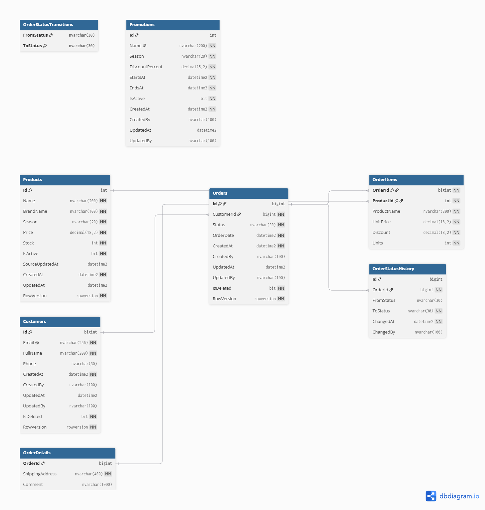
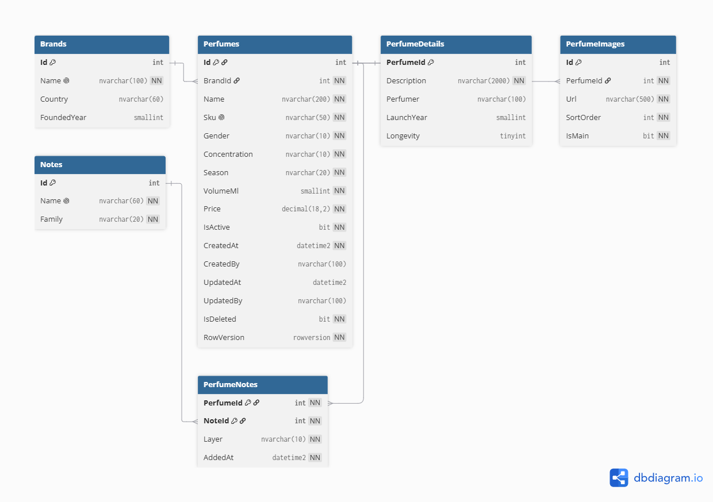

# Nota — інтернет-магазин парфумів

Навчальний проєкт з дисципліни «Технології .NET розробки Web-додатків». Проєкт розвивається в межах лабораторних робіт: проєктування баз даних для мікросервісної архітектури (Лаб. 01), тришаровий Web API на ADO.NET і Dapper (Лаб. 02) та тришаровий Web API на Entity Framework Core (Лаб. 03).

## Зміст

- [Опис предметної області](#опис-предметної-області)
- [Архітектура та контексти](#архітектура-та-контексти)
- [Зв'язки та ERD](#звязки-та-erd)
- [Політика дублювання даних](#політика-дублювання-даних)
- [Структура репозиторію](#структура-репозиторію)
- [Лабораторна робота № 01: бази даних](#лабораторна-робота--01-бази-даних)
- [Лабораторна робота № 02: Orders API](#лабораторна-робота--02-orders-api)
- [Запуск через .NET Aspire](#запуск-через-net-aspire)
- [Ендпоінти API](#ендпоінти-api)
- [Приклади запитів](#приклади-запитів)
- [Перевірка обробки помилок і транзакцій](#перевірка-обробки-помилок-і-транзакцій)
- [Лабораторна робота № 03: Catalog API](#лабораторна-робота--03-catalog-api)
- [Запуск Catalog API](#запуск-catalog-api)
- [Ендпоінти Catalog API](#ендпоінти-catalog-api)
- [Приклади запитів до Catalog API](#приклади-запитів-до-catalog-api)
- [Перевірка Catalog API](#перевірка-catalog-api)
- [Git-процес](#git-процес)

## Опис предметної області

Nota — інтернет-магазин парфумерії. Покупці переглядають аромати, шукають парфуми за брендом, сезоном і нотами піраміди (верхні, серця та базові), оформлюють замовлення й користуються сезонними знижками. Користувачі також залишають відгуки та беруть участь в обговореннях ароматів, а адміністратор керує каталогом і акціями.

Система поділена на три незалежні контексти. Кожен контекст має власну базу даних і відповідає за свою частину предметної області. Між базами немає зовнішніх ключів: для взаємодії використовуються ідентифікатори та визначена політика дублювання даних.

## Архітектура та контексти

| № | Контекст | База даних | Технологія | Основні сутності |
|---|---|---|---|---|
| 1 | Замовлення (Orders) | `PerfumeOrdersDb` | SQL Server, ADO.NET, Dapper | `Customers`, `Orders`, `OrderDetails`, `OrderItems`, `OrderStatusHistory`, `OrderStatusTransitions`, `Promotions`, `Products` |
| 2 | Каталог (Catalog) | `PerfumeCatalogDb` | SQL Server, EF Core | `Brands`, `Perfumes`, `PerfumeDetails`, `PerfumeImages`, `Notes`, `PerfumeNotes` |
| 3 | Відгуки (Reviews) | `PerfumeReviewsDb` | MongoDB | `reviews`, `discussions`, `discussionMessages`, `ratingSummaries` |

У межах Лабораторної роботи № 02 реалізовано контекст **Orders**, а в Лабораторній роботі № 03 — контекст **Catalog**. Кожен із них є окремою вертикаллю від доступу до бази даних до HTTP API з однаковою тришаровою будовою.

### Тришарова архітектура Orders

```text
HTTP-клієнт / Swagger
        |
        v
Orders.Api       HTTP-контракт, маршрутизація, Swagger, обробка помилок
        |
        v
Orders.Bll       бізнес-правила, сервіси, DTO, мапінг і валідація
        |
        v
Orders.Dal       репозиторії, SQL-запити, ADO.NET, Dapper, Unit of Work
        |
        v
SQL Server       PerfumeOrdersDb
```

`Orders.Domain` містить спільні доменні моделі, константи та доменні винятки, які використовують DAL і BLL.

Залежності спрямовані в один бік: `Api → Bll → Dal`. API звертається до бізнес-логіки через сервіси, а не викликає репозиторії безпосередньо. SQL-запити зберігаються в DAL; контролери не повинні містити SQL або бізнес-правила.

## Зв'язки та ERD

У SQL-базах зв'язки реалізовані в межах відповідної бази даних.

| Тип зв'язку | БД замовлень | БД каталогу |
|---|---|---|
| 1:1 | `Orders` ↔ `OrderDetails` | `Perfumes` ↔ `PerfumeDetails` |
| 1:N | `Customers` → `Orders` | `Brands` → `Perfumes` |
| M:N | `Orders` ↔ `Products` через `OrderItems` | `Perfumes` ↔ `Notes` через `PerfumeNotes` |

`PerfumeNotes` містить власні поля, зокрема `Layer` і `AddedAt`. Зовнішні ключі використовуються для зв'язків усередині кожної SQL-бази. Між різними базами даних `FOREIGN KEY` не створюються.

### ERD

- База замовлень: див. [опис контекстів і матеріали ERD](docs/domain-and-contexts.md) та вихідний файл [orders.dbml](docs/orders.dbml).
- База каталогу: див. [catalog.dbml](docs/catalog.dbml).

БД Замовлень:



БД Каталогу:




Таблиця `Promotions` не має зовнішніх ключів на каталог: сезонна знижка зіставляється з товаром за значенням `Season`. `OrderStatusTransitions` містить дозволені переходи статусів, які використовує процедура `usp_ChangeOrderStatus`.

## Політика дублювання даних

Дублювання окремих полів потрібне для автономності сервісів і зменшення кількості синхронних звернень між ними. Для кожного поля визначено власника даних і спосіб узгодження.

| Поле | Де зберігається | Джерело (власник даних) | Політика узгодженості |
|---|---|---|---|
| `OrderItems.ProductName`, `UnitPrice` | БД замовлень | `Perfumes` у БД каталогу | Знімок назви та ціни на момент оформлення; надалі не оновлюється |
| `OrderItems.Discount` | БД замовлень | `Promotions` у БД замовлень | Знімок знижки на момент додавання позиції |
| `Products.Name`, `BrandName`, `Price`, `Season`, `IsActive` | Локальна копія довідника в БД замовлень | `Perfumes` і `Brands` у БД каталогу | Оновлюється подіями з каталогу |
| `Products.Stock` | БД замовлень | Контекст Orders | Власне поле Orders; залишок змінює сервіс замовлень |
| `reviews.productName`, `brandName` | MongoDB, база відгуків | `Perfumes` і `Brands` у БД каталогу | Оновлюється подіями з каталогу |
| `discussions.productName` | MongoDB, база відгуків | `Perfumes` у БД каталогу | Оновлюється подіями з каталогу |
| `ratingSummaries.productName`, `brandName` | MongoDB, база відгуків | `Perfumes` і `Brands` у БД каталогу | Оновлюється подіями з каталогу |
| `reviews.author.displayName` | MongoDB, база відгуків | Дані клієнта з контексту Orders | Знімок імені на момент написання відгуку |

Докладні пояснення наведено в [docs/duplication-policy.md](docs/duplication-policy.md).

## Структура репозиторію

```text
perfume-shop/
├── README.md
├── docs/
│   ├── domain-and-contexts.md
│   ├── duplication-policy.md
│   ├── orders.dbml
│   ├── catalog.dbml
│   ├── erd-orders.png
│   ├── erd-catalog.png
│   └── mongo-examples/
├── db/
│   ├── p1/
│   │   ├── schema.sql
│   │   ├── procedures.sql
│   │   ├── seed.sql
│   │   └── checks.sql
│   ├── p2/
│   │   ├── schema.sql
│   │   └── seed.sql
│   └── p3/
│       ├── collections.js
│       ├── seed.js
│       └── queries.js
├── Platform.slnx
├── Platform.AppHost/
└── Services/
    ├── Orders/
    │   ├── Orders.Api/
    │   ├── Orders.Bll/
    │   ├── Orders.Dal/
    │   └── Orders.Domain/
    └── Catalog/
        ├── Catalog.Api/
        ├── Catalog.Bll/
        ├── Catalog.Dal/
        └── Catalog.Domain/
```

`Platform.slnx`, `Platform.AppHost` і `Services/Orders` — рішення Лабораторної роботи № 02; `Services/Catalog` додано в Лабораторній роботі № 03.

## Лабораторна робота № 01: бази даних

### Вимоги до середовища

- SQL Server 2017 або новіший.
- SQL Server Management Studio (SSMS).
- MongoDB 6+ і `mongosh` для бази відгуків.

### Розгортання SQL Server

Відкрийте кожен SQL-файл у SSMS та виконайте його командою **Execute (F5)**. Скрипти потрібно виконувати в такому порядку:

1. `db/p1/schema.sql` — створення `PerfumeOrdersDb`, таблиць, обмежень та індексів.
2. `db/p1/procedures.sql` — створення збережуваних процедур.
3. `db/p1/seed.sql` — додавання тестових даних.
4. `db/p1/checks.sql` — контрольні запити (необов'язково).
5. `db/p2/schema.sql` — створення `PerfumeCatalogDb`, таблиць, індексів і представлень.
6. `db/p2/seed.sql` — початкові довідники та тестові дані.

Seed-скрипти розраховані на повторний запуск без створення дублікатів.

Скрипти `db/p2` — рішення Лабораторної роботи № 01. Для запуску Catalog API (Лаб. 03) базу `PerfumeCatalogDb` створюють міграції EF Core, див. [Запуск Catalog API](#запуск-catalog-api).

### Розгортання MongoDB

Із кореня репозиторію виконайте:

```powershell
mongosh "mongodb://localhost:27017/PerfumeReviewsDb" --file db/p3/collections.js
mongosh "mongodb://localhost:27017/PerfumeReviewsDb" --file db/p3/seed.js
mongosh "mongodb://localhost:27017/PerfumeReviewsDb" --file db/p3/queries.js
```

`collections.js` створює колекції, правила валідації та індекси; `seed.js` додає тестові документи; `queries.js` містить приклади запитів та агрегацій. Приклади документів у форматі JSON розміщено в `docs/mongo-examples/`.

### Збережувані процедури БД замовлень

| Процедура | Призначення |
|---|---|
| `usp_CreateOrder` | Створення замовлення, деталей і запису в історії статусів у межах однієї транзакції |
| `usp_AddOrderItem` | Додавання позиції, збереження знімка назви й ціни та застосування сезонної знижки |
| `usp_ConfirmOrder` | Перевірка та списання залишку, перехід у `StockConfirmed` |
| `usp_ChangeOrderStatus` | Зміна статусу лише за дозволеним переходом |
| `usp_GetOrderById` | Отримання замовлення, позицій та історії статусів |
| `usp_GetCustomerOrders` | Історія замовлень клієнта з фільтром за статусом і пагінацією |

Основний життєвий цикл замовлення: `Submitted → AwaitingValidation → StockConfirmed → Paid → Shipped`. Скасування (`Cancelled`) дозволене лише до оплати. Недопустимий перехід має завершуватися контрольованою помилкою.

| Код SQL | Значення |
|---|---|
| `50001` | Замовлення не знайдено |
| `50002` | Недопустимий перехід статусу |
| `50003` | Недостатньо товару на складі |
| `50004` | Товар не знайдено або він неактивний |
| `50005` | Позиції можна змінювати лише у статусі `Submitted` |
| `50006` | Клієнта не знайдено |
| `50007` | Статус `StockConfirmed` можна встановити лише через `usp_ConfirmOrder` |
| `50008` | Кількість має бути додатною |
| `50009` | Замовлення не містить позицій |

## Лабораторна робота № 02: Orders API

### Призначення

Orders API надає HTTP-інтерфейс для роботи з клієнтами, товарами та замовленнями. Назва, ціна й сезон товару є копією з контексту «Каталог», тому через API змінюється лише залишок (`PUT /api/products/{id}/stock`). Бізнес-операції реалізовано в BLL, SQL-доступ винесено в DAL (чистий ADO.NET і Dapper).

### Основні компоненти

| Компонент | Відповідальність |
|---|---|
| `Orders.Api` | Контролери, маршрутизація, Swagger, конфігурація, централізована обробка помилок |
| `Orders.Bll` | Сервіси, бізнес-правила, DTO, AutoMapper і бізнес-валідація |
| `Orders.Dal` | Репозиторії, параметризовані SQL-запити, ADO.NET, Dapper і Unit of Work |
| `Orders.Domain` | Доменні моделі, константи й доменні винятки |
| `Platform.AppHost` | Запуск API та підключення до бази через .NET Aspire |

### Доступ до даних

- `IGenericRepository<T>` визначає спільні CRUD-операції для відповідних репозиторіїв.
- `CustomerRepository` демонструє чистий ADO.NET: параметризовані команди та ручне читання результатів.
- `ProductRepository` і `OrderRepository` використовують Dapper для типових операцій та спеціалізованих запитів.
- `UnitOfWork` координує репозиторії через спільне з'єднання й транзакцію.
- SQL-запити виконуються в DAL; значення передаються як параметри, а не конкатенуються з текстом SQL.
- Операції доступу до бази виконуються асинхронно.
- Знімок позиції замовлення (`ProductName`, `UnitPrice`, `Discount`) записує збережувана процедура `usp_AddOrderItem` у тій самій транзакції, що й створення замовлення; `POST /api/orders` повертає ці значення в `items`.

### Технології

| Компонент | Версія |
|---|---|
| .NET | 9 |
| .NET Aspire (AppHost) | 9.5.2 |
| Dapper | 2.1.89 |
| Microsoft.Data.SqlClient | 7.1.1 |
| AutoMapper | 14.0.0 (ліцензійний ключ не потрібен) |
| Serilog.AspNetCore | 10.0.0 |
| Swashbuckle.AspNetCore | 9.0.6 |

### Транзакції та конкурентність

Транзакційна операція виконується так: Unit of Work відкриває транзакцію, репозиторії виконують зміни, після успіху викликається `Commit`, у разі помилки — `Rollback`. Транзакційні сценарії: створення замовлення (`POST /api/orders`: перевірка клієнта, перевірка товарів і додавання позицій у трьох репозиторіях), підтвердження замовлення і зміна статусу.

Рівень ізоляції — `ReadCommitted`: операція читає лише зафіксовані дані, а блокування короткі. Вищі рівні (`RepeatableRead`, `Serializable`) дають менше аномалій читання, але більше блокувань і ризик взаємних блокувань (deadlock). Таймаут команд — 30 с (значення `SqlCommand` за замовчуванням).

Підхід до конкурентності — песимістичний: збережувані процедури блокують рядок замовлення через `UPDLOCK`, тому два одночасні підтвердження одного замовлення виконуються по черзі. Колонка `RowVersion` з Лаб. 01 у цьому сервісі не перевіряється.

Процедури мають `SET XACT_ABORT ON`, тому при помилці (наприклад, нестача залишку) сервер сам відкочує всю транзакцію. `UnitOfWork.RollbackAsync` це враховує і не намагається відкотити транзакцію вдруге.

### Валідація та обробка помилок

Перший рівень валідації — DataAnnotations на DTO (обов'язкові поля, діапазони, формат email): некоректний запит відхиляється з `400` ще до виклику сервісу. Другий рівень — BLL: правила, яким потрібен стан бази (клієнт існує, товар існує й активний, статус дозволений, email не дублюється).

Помилки збережуваних процедур перетворюються на доменні винятки в DAL (`SqlErrorTranslator`), а глобальний обробник `DomainExceptionHandler` повертає їх у форматі `ProblemDetails`:

| Виняток | HTTP-статус | Приклад |
|---|---|---|
| `ValidationException` та помилки DataAnnotations | `400 Bad Request` | порожній email, невідомий статус |
| `NotFoundException` | `404 Not Found` | замовлення чи клієнта з таким Id немає |
| `BusinessConflictException` | `409 Conflict` | недопустимий перехід статусу, нестача залишку, дубль email |
| інші винятки | `500 Internal Server Error` | клієнту повертається загальний опис, деталі пишуться в лог |

## Запуск через .NET Aspire

### Передумови

- .NET 9 SDK (перевірка: `dotnet --list-sdks`).
- Visual Studio 2022 (17.14 або новіша) із навантаженням **ASP.NET and web development** або .NET CLI.
- SQL Server LocalDB або інший локальний SQL Server.
- Docker Desktop — лише для варіанта з SQL Server у контейнері.

### Два режими бази даних

Режим вибирає параметр `UseSqlContainer` у `Platform.AppHost/appsettings.json`.

| Режим | `UseSqlContainer` | База |
|---|---|---|
| Існуюча база (за замовчуванням) | `false` | Підключення до `PerfumeOrdersDb` за рядком `ConnectionStrings:OrdersDb` із `Platform.AppHost/appsettings.json` (за замовчуванням LocalDB) |
| SQL Server у контейнері | `true` | Aspire створює контейнер із томом даних і порожню базу `PerfumeOrdersDb` |

**Підготовка бази.** В обох режимах до бази потрібно застосувати `db/p1/schema.sql`, `db/p1/procedures.sql` і `db/p1/seed.sql` (у SSMS або через `sqlcmd`). У режимі контейнера адресу й порт SQL Server видно в Aspire Dashboard, порожній контейнер таблиць не містить. У режимі існуючої бази достатньо один раз виконати ці скрипти на своєму SQL Server.

Увімкнути контейнер без редагування файлу можна змінною оточення:

```powershell
$env:UseSqlContainer = "true"
```

### Запуск усієї системи

З кореня репозиторію:

```powershell
dotnet run --project Platform.AppHost
```

Aspire Dashboard відкривається за адресою з консолі (за замовчуванням `https://localhost:17062`). У ньому API `orders-api` і ресурс бази мають статус `Running`. Адресу API беріть з колонки **Endpoints**, Swagger доступний за шляхом `/swagger`.

### Рядок підключення

Рядок підключення зберігається в `appsettings.json` і перевизначається змінною оточення (подвійне підкреслення замість двокрапки):

```powershell
$env:ConnectionStrings__OrdersDb = "Server=localhost;Database=PerfumeOrdersDb;Trusted_Connection=True;TrustServerCertificate=True"
```

Паролі й інші секрети в репозиторій не додаються.

### Запуск API без Aspire

```powershell
dotnet run --project Services/Orders/Orders.Api --launch-profile https
```

API стартує на `https://localhost:7130`, Swagger — `https://localhost:7130/swagger`. Рядок підключення береться з `Services/Orders/Orders.Api/appsettings.json` (за замовчуванням LocalDB) або зі змінної оточення `ConnectionStrings__OrdersDb`.

## Ендпоінти API


| Метод | Шлях | Призначення | Типові відповіді |
|---|---|---|---|
| `GET` | `/api/customers` | Отримати список клієнтів | `200` |
| `GET` | `/api/customers/{id}` | Отримати клієнта за ID | `200`, `404` |
| `POST` | `/api/customers` | Створити клієнта | `201`, `400`, `409` |
| `PUT` | `/api/customers/{id}` | Оновити клієнта | `200`, `400`, `404`, `409` |
| `DELETE` | `/api/customers/{id}` | Видалити клієнта (м'яке видалення) | `204`, `404` |
| `GET` | `/api/products` | Отримати товари; можливий фільтр `season` | `200`, `400` |
| `GET` | `/api/products/{id}` | Отримати товар за ID | `200`, `404` |
| `PUT` | `/api/products/{id}/stock` | Змінити залишок | `200`, `400`, `404` |
| `GET` | `/api/orders/{id}` | Отримати замовлення з позиціями | `200`, `404` |
| `GET` | `/api/customers/{customerId}/orders` | Отримати замовлення клієнта; можливі `status`, `page`, `pageSize` | `200`, `400`, `404` |
| `POST` | `/api/orders` | Створити замовлення | `201`, `400`, `404`, `409` |
| `PUT` | `/api/orders/{id}` | Оновити адресу та коментар замовлення | `200`, `400`, `404`, `409` |
| `POST` | `/api/orders/{id}/confirm` | Підтвердити наявність і виконати списання залишку | `204`, `404`, `409` |
| `PUT` | `/api/orders/{id}/status` | Змінити статус із перевіркою переходу | `204`, `400`, `404`, `409` |
| `DELETE` | `/api/orders/{id}` | Видалити замовлення за дозволених статусів | `204`, `404`, `409` |

Створення ресурсу повертає `201 Created` із заголовком `Location`. Операції без тіла відповіді (`confirm`, зміна статусу, видалення) повертають `204 No Content`. Помилки валідації тіла запиту (`POST` і `PUT`) повертають `400`.

## Приклади запитів

`BASE` — адреса API: з Aspire Dashboard (колонка **Endpoints**) або `https://localhost:7130` при запуску API напряму.

```powershell
$BASE = "https://localhost:7130"

# список клієнтів
Invoke-RestMethod -Method Get -Uri "$BASE/api/customers"

# створити клієнта
$body = @{
    email    = "test@example.com"
    fullName = "Test User"
    phone    = "+380501112233"
} | ConvertTo-Json

Invoke-RestMethod -Method Post -Uri "$BASE/api/customers" -ContentType "application/json" -Body $body

# товари зимового сезону
Invoke-RestMethod -Method Get -Uri "$BASE/api/products?season=Winter"

# замовлення клієнта 1 зі статусом Paid, перша сторінка
Invoke-RestMethod -Method Get -Uri "$BASE/api/customers/1/orders?status=Paid&page=1&pageSize=10"

# одне замовлення з позиціями
Invoke-RestMethod -Method Get -Uri "$BASE/api/orders/1"
```

### curl і Postman

`curl.exe` (а не `curl`, який у PowerShell є псевдонімом `Invoke-WebRequest`). Параметр `-k` потрібен для локального сертифіката розробки, `-i` показує код і заголовки відповіді.

```powershell
# список товарів зимового сезону
curl.exe -k -i "$BASE/api/products?season=Winter"

# підтвердити замовлення (відповідь 204 або 409)
curl.exe -k -i -X POST "$BASE/api/orders/2/confirm"

# створити клієнта: JSON передається з файлу, щоб не мучитись з лапками в PowerShell
[System.IO.File]::WriteAllText("body.json", '{"email":"test@example.com","fullName":"Test User"}')
curl.exe -k -i -X POST "$BASE/api/customers" -H "Content-Type: application/json" --data-binary "@body.json"
```

Postman: **Import** → **Link**, вставити `<BASE>/swagger/v1/swagger.json` (де `<BASE>` — адреса API). У колекції з'являться всі ендпоінти з прикладами тіл запитів.

Створення замовлення (`POST /api/orders`). Позиція фіксує назву, ціну й сезонну знижку на момент замовлення:

```json
{
  "customerId": 1,
  "shippingAddress": "Kyiv, Khreshchatyk 1",
  "comment": "Подарункова упаковка",
  "items": [
    { "productId": 1, "units": 2 },
    { "productId": 2, "units": 1 }
  ]
}
```

Підтвердження замовлення і зміна статусу:

```powershell
Invoke-RestMethod -Method Post -Uri "$BASE/api/orders/3/confirm"

$status = @{ status = "Paid" } | ConvertTo-Json
Invoke-RestMethod -Method Put -Uri "$BASE/api/orders/3/status" -ContentType "application/json" -Body $status
```

Приклад відповіді `409 Conflict` на повторне підтвердження замовлення (`POST /api/orders/2/confirm`):

```json
{
  "status": 409,
  "title": "Business rule conflict",
  "detail": "Stock can be confirmed only for a new order",
  "instance": "/api/orders/2/confirm",
  "traceId": "0HN..."
}
```

## Перевірка обробки помилок і транзакцій

Сценарії зручно виконувати у Swagger (`/swagger`), бо Swagger показує код і тіло відповіді. Для свіжої бази після `seed.sql`: замовлення 1 має статус `Paid`, 2 — `StockConfirmed`, 3 — `Submitted`.

| Сценарій | Запит | Очікуваний результат |
|---|---|---|
| Спецсимволи в параметрі | `POST /api/customers` з `fullName` = `Conor O'Brien` | `201`, помилки SQL немає: значення передається параметром |
| Валідація DTO | `POST /api/customers` з `email` = `not-an-email` | `400` у форматі ProblemDetails з переліком полів |
| Неіснуючий Id | `GET /api/orders/9999` | `404`, а не `500` |
| Повторне підтвердження | `POST /api/orders/2/confirm` | `409`, ProblemDetails |
| Недопустимий перехід | `PUT /api/orders/3/status` зі статусом `Shipped` | `409`: неоплачене замовлення відвантажити не можна |
| Відкат при створенні замовлення | `POST /api/orders` для клієнта 1 з двома позиціями: `productId` 1 і `productId` 99999 | `404` (другого товару немає); у `GET /api/customers/1/orders` кількість замовлень не змінилась, бо створене замовлення і перша позиція відкотились |
| Відкат при нестачі залишку | `PUT /api/products/7/stock` зі `stock` = 1, потім `POST /api/orders/3/confirm` | `409`; у `GET /api/products/3` залишок не змінився; після перевірки поверніть залишок товару 7 до 14 |

## Лабораторна робота № 03: Catalog API

### Призначення

Catalog API — сервіс каталогу парфумів: бренди, ноти й самі парфуми. Він підтримує фільтрацію за брендом, сезоном, статтю, ціною та нотами піраміди, сортування й пагінацію. Доступ до даних реалізовано на Entity Framework Core (Code First): модель описана в коді, а схема бази створюється міграціями. Сервіс є власником даних про ціну, назву, бренд і сезон парфуму; інші контексти зберігають їхні копії (див. політику дублювання).

### Основні компоненти

| Компонент | Відповідальність |
|---|---|
| `Catalog.Api` | Контролери, маршрутизація, Swagger, Serilog, централізована обробка помилок, запуск міграцій і сідінгу |
| `Catalog.Bll` | Сервіси, DTO, AutoMapper, валідатори FluentValidation, специфікації |
| `Catalog.Dal` | `CatalogDbContext`, конфігурації Fluent API, міграції, репозиторії, Unit of Work, сідінг |
| `Catalog.Domain` | Сутності з бізнес-правилами, константи, доменні винятки |

### Технології

| Компонент | Версія |
|---|---|
| .NET | 9 |
| Microsoft.EntityFrameworkCore.SqlServer, Microsoft.EntityFrameworkCore.Design | 9.0.x |
| Ardalis.Specification.EntityFrameworkCore | 9.3.1 |
| AutoMapper | 14.0.0 |
| FluentValidation.DependencyInjectionExtensions | остання стабільна |
| Serilog.AspNetCore | 10.0.0 |
| Swashbuckle.AspNetCore | 9.0.6 |

### Модель даних

Сутності: `Brand`, `Perfume`, `PerfumeDetail`, `PerfumeImage`, `Note`, `PerfumeNote`. Схема збігається зі схемою `db/p2`.

| Тип зв'язку | Сутності |
|---|---|
| 1:1 | `Perfume` ↔ `PerfumeDetail` (ключ `PerfumeId` є водночас зовнішнім) |
| 1:N | `Brand` → `Perfume`, `Perfume` → `PerfumeImage` |
| M:N | `Perfume` ↔ `Note` через явну проміжну сутність `PerfumeNote` із власними полями `Layer` (верхня нота, серце, база) та `AddedAt` і складеним ключем `(PerfumeId, NoteId)` |

Бізнес-правила живуть у самій сутності `Perfume`: закриті сеттери, перевірки в конструкторі (бренд, обсяг і ціна додатні, стать, концентрація й сезон зі списку допустимих значень) та методи `ChangePrice`, `Rename`, `ChangeSeason`, `Activate`, `Deactivate`, `MarkDeleted`, `SetDetail`, `AddImage`, `AddNote`.

Конфігурація Fluent API розділена на класи `IEntityTypeConfiguration<T>` (по одному на сутність) і підключається централізовано через `ApplyConfigurationsFromAssembly`. Вона задає назви таблиць, ключі, довжини рядків, `decimal(18,2)`, CHECK-обмеження, унікальні та фільтровані індекси, `rowversion` і поведінку каскадів: `Cascade` для частин агрегату, `Restrict` для брендів і нот з пов'язаними записами.

### Міграції

Міграції лежать у `Services/Catalog/Catalog.Dal/Migrations`: `InitialCreate` (схема) і `SeedReferenceData` (довідники). SQL-скрипт початкової міграції: `Migrations/InitialCreate.sql`.

```powershell
dotnet tool install --global dotnet-ef --version "9.0.*"

# нова міграція
dotnet ef migrations add <Name> --project Services/Catalog/Catalog.Dal --startup-project Services/Catalog/Catalog.Api

# застосувати до бази
dotnet ef database update --project Services/Catalog/Catalog.Dal --startup-project Services/Catalog/Catalog.Api

# SQL-скрипт міграцій
dotnet ef migrations script --project Services/Catalog/Catalog.Dal --startup-project Services/Catalog/Catalog.Api
```

Проєкт `Catalog.Dal` містить `DbContext`, а `Catalog.Api` — рядок підключення, тому в командах вказано обидва проєкти. Застосунок також сам застосовує міграції під час запуску (`MigrateAsync`).

### Репозиторії та Unit of Work

`GenericRepository<T>` — асинхронний універсальний репозиторій на `DbSet<T>`. Три специфічні репозиторії демонструють три способи читання пов'язаних даних:

| Репозиторій | Спосіб | Кількість SQL-запитів |
|---|---|---|
| `PerfumeRepository.GetWithDetailsAsync` | Eager Loading (`Include`/`ThenInclude`): бренд, деталі, фото й ноти парфуму | 1 |
| `NoteRepository.GetWithPerfumesAsync` | Explicit Loading (`Entry().Collection().LoadAsync()`): нота, потім її парфуми | 2 |
| `PerfumeNoteRepository` | LINQ to Entities через проміжну сутність: парфуми за нотою (і рівнем піраміди), парфуми з усіма вибраними нотами | 1 |

`UnitOfWork` об'єднує репозиторії, а зміни записує єдиний виклик `SaveChangesAsync()` в одній транзакції. Репозиторії лише додають, змінюють і видаляють сутності в контексті.

### BLL: DTO, AutoMapper, валідація

Сервіси працюють лише через Unit of Work і не звертаються до EF напряму. DTO описують контракти API, AutoMapper перетворює сутності на DTO.

Валідація має два рівні, що не дублюють одне одного. DataAnnotations на DTO перевіряють прості правила (обов'язкові поля, довжина, діапазон). FluentValidation перевіряє складніші (формат SKU, допустимі значення, унікальність нот у запиті, `MinPrice` не більша за `MaxPrice`) і викликається в контролерах явно. Помилки повертаються у форматі `ValidationProblemDetails`. Правила, яким потрібні дані з бази (унікальність SKU, існування бренду й нот), перевіряє BLL.

### Пагінація, фільтрація й сортування

`GET /api/perfumes` приймає такі параметри:

| Параметр | Значення |
|---|---|
| `page` | номер сторінки, з 1 (за замовчуванням 1) |
| `pageSize` | розмір сторінки, 1–100 (за замовчуванням 20) |
| `search` | частина назви парфуму або бренду |
| `brandId` | Id бренду |
| `season` | `Spring`, `Summer`, `Autumn`, `Winter`, `AllYear` |
| `gender` | `Women`, `Men`, `Unisex` |
| `minPrice`, `maxPrice` | межі ціни |
| `notes` | назва ноти; параметр можна повторити, парфум має містити **усі** вказані ноти |
| `sortBy`, `sortDir` | `name` або `price`; `asc` або `desc` |

Відповідь містить `items`, `totalCount`, `page`, `pageSize`, `totalPages`, `hasNext`, `hasPrevious`; метадані також повертаються в заголовках `X-Total-Count`, `X-Page`, `X-Page-Size`, `X-Total-Pages`. Фільтрація, сортування й пагінація виконуються на рівні SQL: умови, `OFFSET`/`FETCH` і `COUNT` будує специфікація, у пам'ять завантажується лише потрібна сторінка.

### Specification pattern

Критерії вибірки (`Where`, `Include`, сортування, `Skip`/`Take`) винесено в класи специфікацій на `Ardalis.Specification`: `PerfumesFilterSpec` (каталог з фільтрами), `PerfumesByIdsSpec` і `BrandByNameSpec`. Репозиторій приймає специфікацію методами `ListAsync` і `CountAsync`. Для підрахунку `totalCount` береться лише умова відбору без пагінації та сортування. Нова специфікація не потребує змін у репозиторії.

### Сідінг

Сідінг ідемпотентний і складається з двох частин:

- `HasData` (модельний сідінг): 5 брендів і 28 нот з фіксованими Id входять у міграцію `SeedReferenceData`;
- програмний сідінг (`DbInitializer`) після `MigrateAsync()`: 10 парфумів з деталями, фото й нотами. Якщо парфуми вже є, нічого не додається. У production сідінг вимкнено. Id парфумів фіксовані (1–10) і збігаються з `Products.Id` у базі Замовлень та `productId` у MongoDB.

### Обробка помилок і журнал

Глобальний обробник `DomainExceptionHandler` повертає помилки у форматі `ProblemDetails` і логує кожен виняток один раз:

| Виняток | HTTP-статус |
|---|---|
| `EntityNotFoundException` | `404 Not Found` |
| `ValidationException` та помилки валідації DTO | `400 Bad Request` |
| `ConflictException`, `DomainException` | `409 Conflict` |
| `DbUpdateConcurrencyException`, `DbUpdateException` | `409 Conflict` (деталі помилки бази клієнту не віддаються) |
| інші винятки | `500 Internal Server Error` |

Журнал Serilog структурований: кожен запис має властивості `CorrelationId` (з заголовка `X-Correlation-Id` або `TraceIdentifier`) і `RequestPath`. Рівні задаються в `appsettings.json`. SQL-команди EF Core видно в консолі (`Microsoft.EntityFrameworkCore.Database.Command` на рівні `Information`), тому можна переконатися, що Eager Loading виконує один запит, а Explicit Loading — два.

## Запуск Catalog API

### Передумови

- .NET 9 SDK, SQL Server LocalDB або інший локальний SQL Server.
- Інструмент `dotnet-ef` версії 9.0.x для роботи з міграціями.

### База даних

База `PerfumeCatalogDb` створюється міграціями під час першого запуску, окремо виконувати SQL-скрипти не потрібно. Якщо база вже створена скриптами `db/p2` з Лаб. 01, видаліть її перед першим запуском, інакше міграція завершиться помилкою «об'єкт уже існує»:

```sql
USE master;
IF DB_ID(N'PerfumeCatalogDb') IS NOT NULL
BEGIN
    ALTER DATABASE PerfumeCatalogDb SET SINGLE_USER WITH ROLLBACK IMMEDIATE;
    DROP DATABASE PerfumeCatalogDb;
END
```

Рядок підключення — `ConnectionStrings:CatalogDb` у `Services/Catalog/Catalog.Api/appsettings.json` (за замовчуванням LocalDB). Його можна перевизначити змінною оточення:

```powershell
$env:ConnectionStrings__CatalogDb = "Server=localhost;Database=PerfumeCatalogDb;Trusted_Connection=True;TrustServerCertificate=True"
```

### Запуск

```powershell
dotnet run --project Services/Catalog/Catalog.Api --launch-profile http
```

Під час запуску застосунок застосовує міграції та виконує сідінг. Swagger відкривається за адресою `http://localhost:5101/swagger` (профіль `https`: `https://localhost:7101/swagger`). Catalog API запускається окремо від `Platform.AppHost` і може працювати одночасно з Orders API, бо порти відрізняються.

## Ендпоінти Catalog API

| Метод | Шлях | Призначення | Типові відповіді |
|---|---|---|---|
| `GET` | `/api/perfumes` | Список парфумів із фільтрами, сортуванням і пагінацією | `200`, `400` |
| `GET` | `/api/perfumes/{id}` | Картка парфуму (Eager Loading) | `200`, `404` |
| `GET` | `/api/perfumes/by-ids?ids=1&ids=5` | Парфуми за списком Id | `200`, `400` |
| `GET` | `/api/perfumes/by-note/{noteName}` | Парфуми за нотою; можливий `layer` | `200`, `400`, `404` |
| `POST` | `/api/perfumes` | Створити парфум із деталями та нотами | `201`, `400`, `404`, `409` |
| `PUT` | `/api/perfumes/{id}` | Змінити назву, сезон, ціну й активність | `200`, `400`, `404`, `409` |
| `PUT` | `/api/perfumes/{id}/price` | Змінити ціну | `200`, `400`, `404` |
| `DELETE` | `/api/perfumes/{id}` | Видалити парфум (м'яке видалення) | `204`, `404` |
| `GET` | `/api/brands` | Список брендів | `200` |
| `GET` | `/api/brands/{id}` | Бренд за Id | `200`, `404` |
| `POST` | `/api/brands` | Створити бренд | `201`, `400`, `409` |
| `PUT` | `/api/brands/{id}` | Оновити бренд | `200`, `400`, `404`, `409` |
| `GET` | `/api/notes` | Список нот; можливий фільтр `family` | `200`, `400` |
| `GET` | `/api/notes/{id}` | Нота за Id | `200`, `404` |
| `GET` | `/api/notes/{id}/perfumes` | Нота та її парфуми (Explicit Loading) | `200`, `404` |
| `POST` | `/api/notes` | Створити ноту | `201`, `400`, `409` |

Створення повертає `201 Created` із заголовком `Location`, видалення — `204 No Content`.

## Приклади запитів до Catalog API

`BASE` — адреса сервісу: `http://localhost:5101`.

```powershell
$BASE = "http://localhost:5101"

# друга сторінка по 5 парфумів
Invoke-RestMethod -Method Get -Uri "$BASE/api/perfumes?page=2&pageSize=5"

# парфуми, що містять і гарбуз, і ваніль
Invoke-RestMethod -Method Get -Uri "$BASE/api/perfumes?notes=Pumpkin&notes=Vanilla"

# осінні парфуми від найдорожчого до найдешевшого
Invoke-RestMethod -Method Get -Uri "$BASE/api/perfumes?season=Autumn&sortBy=price&sortDir=desc"

# парфуми, у яких гарбуз є серцевою нотою
Invoke-RestMethod -Method Get -Uri "$BASE/api/perfumes/by-note/Pumpkin?layer=Heart"

# нота та її парфуми
Invoke-RestMethod -Method Get -Uri "$BASE/api/notes/7/perfumes"
```

```powershell
curl.exe -i "$BASE/api/perfumes/1"
curl.exe -i "$BASE/api/perfumes/9999"
```

Створення парфуму (`POST /api/perfumes`):

```json
{
  "brandId": 1,
  "name": "Velvet Pumpkin Night",
  "sku": "MA-VP-30",
  "gender": "Women",
  "concentration": "EDP",
  "season": "Autumn",
  "volumeMl": 30,
  "price": 1990,
  "detail": { "description": "Тестовий аромат з гарбузом і ваніллю" },
  "notes": [
    { "noteId": 7, "layer": "Heart" },
    { "noteId": 8, "layer": "Base" }
  ]
}
```

Приклад відповіді `404 Not Found` (`GET /api/perfumes/9999`):

```json
{
  "status": 404,
  "title": "Resource not found",
  "detail": "Perfume 9999 not found",
  "instance": "/api/perfumes/9999",
  "traceId": "0HN..."
}
```

Приклад відповіді `400 Bad Request` на `POST /api/perfumes` з `season` = `Fall`:

```json
{
  "title": "One or more validation errors occurred.",
  "status": 400,
  "errors": {
    "Season": [ "Season must be one of: Spring, Summer, Autumn, Winter, AllYear" ]
  }
}
```

## Перевірка Catalog API

Сценарії зручно виконувати у Swagger. Для свіжої бази після сідінгу в каталозі 10 парфумів.

| Сценарій | Запит | Очікуваний результат |
|---|---|---|
| Пагінація | `GET /api/perfumes?page=2&pageSize=5` | 5 парфумів, `totalCount` = 10, `totalPages` = 2 |
| Фільтр за нотами | `GET /api/perfumes?notes=Pumpkin&notes=Vanilla` | один парфум: Pumpkin Velours |
| Фільтр і сортування | `season=Autumn`, `sortBy=price`, `sortDir=desc` | осінні парфуми, першим Smoked Fig |
| Eager Loading | `GET /api/perfumes/1` | у журналі один SQL-запит із `JOIN` |
| Explicit Loading | `GET /api/notes/7/perfumes` | у журналі два окремі SQL-запити |
| Валідація DTO | `POST /api/perfumes` з порожнім `name` | `400` з переліком помилок по полях |
| Валідація FluentValidation | `POST /api/perfumes` з `season` = `Fall` | `400` |
| Унікальність SKU | `POST /api/perfumes` двічі з однаковим `sku` | перший `201`, другий `409` |
| Неіснуючий Id | `GET /api/perfumes/9999` | `404` у форматі ProblemDetails |
| Ідемпотентність сідінгу | зупинити й запустити застосунок ще раз | кількість парфумів у каталозі не змінюється |

## Git-процес

Для розробки використовується така модель гілок:

- `main` — стабільна версія проєкту;
- `develop` — інтеграційна гілка;
- `feature/lab-02-orders-service` — зміни для Лабораторної роботи № 02;
- `feature/lab-03-catalog-service` — зміни для Лабораторної роботи № 03.

Зміни з feature-гілки потрапляють у `develop`, а з `develop` у `main` через Pull Request з описом.