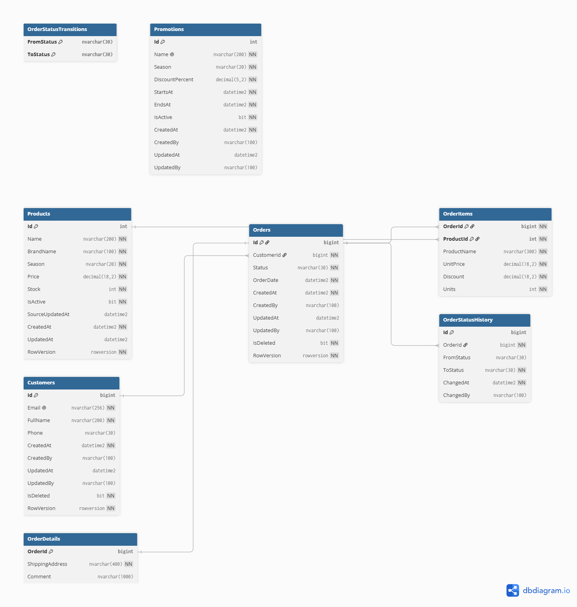
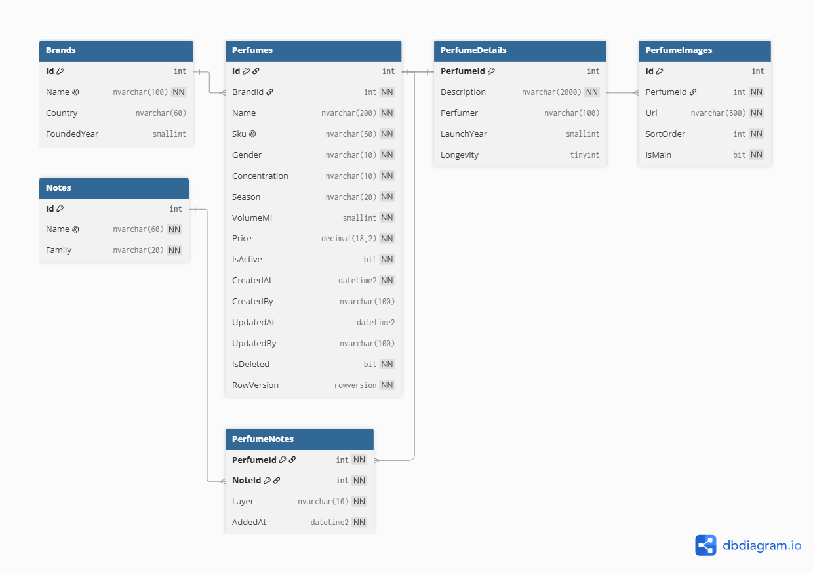

# Nota — інтернет-магазин парфумів

Навчальний проєкт з дисципліни «Технології .NET розробки Web-додатків». Проєкт розвивається в межах лабораторних робіт: проєктування баз даних для мікросервісної архітектури (Лаб. 01), тришаровий Web API на ADO.NET і Dapper (Лаб. 02), тришаровий Web API на Entity Framework Core (Лаб. 03), Clean Architecture з CQRS на MongoDB (Лаб. 04), мікросервісна платформа на .NET Aspire з API Gateway і Aggregator (Лаб. 05), gRPC-взаємодія сервісів і багаторівневе кешування з Redis (Лаб. 06) та стійкість до збоїв, бізнес-метрики й health checks (Лаб. 07).

## Зміст

- [Опис предметної області](#опис-предметної-області)
- [Архітектура та контексти](#архітектура-та-контексти)
- [Зв'язки та ERD](#звязки-та-erd)
- [Політика дублювання даних](#політика-дублювання-даних)
- [Структура репозиторію](#структура-репозиторію)
- [Лабораторна робота № 01: бази даних](#лабораторна-робота--01-бази-даних)
- [Лабораторна робота № 02: Orders API](#лабораторна-робота--02-orders-api)
- [Запуск платформи через .NET Aspire](#запуск-платформи-через-net-aspire)
- [Ендпоінти API](#ендпоінти-api)
- [Приклади запитів](#приклади-запитів)
- [Перевірка обробки помилок і транзакцій](#перевірка-обробки-помилок-і-транзакцій)
- [Лабораторна робота № 03: Catalog API](#лабораторна-робота--03-catalog-api)
- [Запуск Catalog API](#запуск-catalog-api)
- [Ендпоінти Catalog API](#ендпоінти-catalog-api)
- [Приклади запитів до Catalog API](#приклади-запитів-до-catalog-api)
- [Перевірка Catalog API](#перевірка-catalog-api)
- [Лабораторна робота № 04: Reviews API](#лабораторна-робота--04-reviews-api)
- [Запуск Reviews API](#запуск-reviews-api)
- [Ендпоінти Reviews API](#ендпоінти-reviews-api)
- [Приклади запитів до Reviews API](#приклади-запитів-до-reviews-api)
- [Перевірка Reviews API](#перевірка-reviews-api)
- [Лабораторна робота № 05: Aspire-платформа](#лабораторна-робота--05-aspire-платформа)
- [Архітектура платформи](#архітектура-платформи)
- [Маршрути API Gateway](#маршрути-api-gateway)
- [Aggregator і часткові відповіді](#aggregator-і-часткові-відповіді)
- [Спостережуваність: логи, трейси, CorrelationId](#спостережуваність-логи-трейси-correlationid)
- [Лабораторна робота № 06: gRPC і кешування](#лабораторна-робота--06-grpc-і-кешування)
- [Redis в AppHost](#redis-в-apphost)
- [gRPC-контракти](#grpc-контракти)
- [Кешування в Catalog](#кешування-в-catalog)
- [Кеш агрегованої відповіді](#кеш-агрегованої-відповіді)
- [Метрики кешу](#метрики-кешу)
- [Порівняння HTTP і gRPC](#порівняння-http-і-grpc)
- [Лабораторна робота № 07: resilience, метрики та health checks](#лабораторна-робота--07-resilience-метрики-та-health-checks)
- [Resilience в Aggregator](#resilience-в-aggregator)
- [Resilience для Redis](#resilience-для-redis)
- [Бізнес-метрики](#бізнес-метрики)
- [Health checks](#health-checks)
- [Liveness і readiness](#liveness-і-readiness)
- [Стан ресурсів у Dashboard](#стан-ресурсів-у-dashboard)
- [Перевірка Лабораторної роботи № 07](#перевірка-лабораторної-роботи--07)
- [Git-процес](#git-процес)

## Опис предметної області

Nota — інтернет-магазин парфумерії. Покупці переглядають аромати, шукають парфуми за брендом, сезоном і нотами піраміди (верхні, серця та базові), оформлюють замовлення й користуються сезонними знижками. Користувачі також залишають відгуки та беруть участь в обговореннях ароматів, а адміністратор керує каталогом і акціями.

Система поділена на три незалежні контексти. Кожен контекст має власну базу даних і відповідає за свою частину предметної області. Між базами немає зовнішніх ключів: для взаємодії використовуються ідентифікатори та визначена політика дублювання даних.

## Архітектура та контексти

| № | Контекст | База даних | Технологія | Основні сутності |
|---|---|---|---|---|
| 1 | Замовлення (Orders) | `PerfumeOrdersDb` | SQL Server, ADO.NET, Dapper | `Customers`, `Orders`, `OrderDetails`, `OrderItems`, `OrderStatusHistory`, `OrderStatusTransitions`, `Promotions`, `Products` |
| 2 | Каталог (Catalog) | `PerfumeCatalogDb` | SQL Server, EF Core | `Brands`, `Perfumes`, `PerfumeDetails`, `PerfumeImages`, `Notes`, `PerfumeNotes` |
| 3 | Відгуки (Reviews) | `PerfumeReviewsDb` | MongoDB | `reviews`, `discussions`, `discussionMessages`, `ratingSummaries` |

У межах Лабораторної роботи № 02 реалізовано контекст **Orders**, у Лабораторній роботі № 03 — контекст **Catalog**: обидва мають тришарову будову (Api → Bll → Dal). У Лабораторній роботі № 04 реалізовано контекст **Reviews** за принципами Clean Architecture з CQRS: чотири шари, де домен не залежить ні від бази, ні від API.

### Тришарова архітектура Orders

```text
HTTP-клієнт / Swagger
        |
        v
Orders.Api       HTTP-контракт, маршрутизація, Swagger, обробка помилок
        |
        v
Orders.Bll       бізнес-правила, сервіси, DTO, мапінг і валідація
        |
        v
Orders.Dal       репозиторії, SQL-запити, ADO.NET, Dapper, Unit of Work
        |
        v
SQL Server       PerfumeOrdersDb
```

`Orders.Domain` містить спільні доменні моделі, константи та доменні винятки, які використовують DAL і BLL.

Залежності спрямовані в один бік: `Api → Bll → Dal`. API звертається до бізнес-логіки через сервіси, а не викликає репозиторії безпосередньо. SQL-запити зберігаються в DAL; контролери не повинні містити SQL або бізнес-правила.

## Зв'язки та ERD

У SQL-базах зв'язки реалізовані в межах відповідної бази даних.

| Тип зв'язку | БД замовлень | БД каталогу |
|---|---|---|
| 1:1 | `Orders` ↔ `OrderDetails` | `Perfumes` ↔ `PerfumeDetails` |
| 1:N | `Customers` → `Orders` | `Brands` → `Perfumes` |
| M:N | `Orders` ↔ `Products` через `OrderItems` | `Perfumes` ↔ `Notes` через `PerfumeNotes` |

`PerfumeNotes` містить власні поля, зокрема `Layer` і `AddedAt`. Зовнішні ключі використовуються для зв'язків усередині кожної SQL-бази. Між різними базами даних `FOREIGN KEY` не створюються.

### ERD

- База замовлень: див. [опис контекстів і матеріали ERD](docs/domain-and-contexts.md) та вихідний файл [orders.dbml](docs/orders.dbml).
- База каталогу: див. [catalog.dbml](docs/catalog.dbml).

БД Замовлень:



БД Каталогу:




Таблиця `Promotions` не має зовнішніх ключів на каталог: сезонна знижка зіставляється з товаром за значенням `Season`. `OrderStatusTransitions` містить дозволені переходи статусів, які використовує процедура `usp_ChangeOrderStatus`.

## Політика дублювання даних

Дублювання окремих полів потрібне для автономності сервісів і зменшення кількості синхронних звернень між ними. Для кожного поля визначено власника даних і спосіб узгодження.

| Поле | Де зберігається | Джерело (власник даних) | Політика узгодженості |
|---|---|---|---|
| `OrderItems.ProductName`, `UnitPrice` | БД замовлень | `Perfumes` у БД каталогу | Знімок назви та ціни на момент оформлення; надалі не оновлюється |
| `OrderItems.Discount` | БД замовлень | `Promotions` у БД замовлень | Знімок знижки на момент додавання позиції |
| `Products.Name`, `BrandName`, `Price`, `Season`, `IsActive` | Локальна копія довідника в БД замовлень | `Perfumes` і `Brands` у БД каталогу | Оновлюється подіями з каталогу |
| `Products.Stock` | БД замовлень | Контекст Orders | Власне поле Orders; залишок змінює сервіс замовлень |
| `reviews.productName`, `brandName` | MongoDB, база відгуків | `Perfumes` і `Brands` у БД каталогу | Оновлюється подіями з каталогу |
| `discussions.productName` | MongoDB, база відгуків | `Perfumes` у БД каталогу | Оновлюється подіями з каталогу |
| `ratingSummaries.productName`, `brandName` | MongoDB, база відгуків | `Perfumes` і `Brands` у БД каталогу | Оновлюється подіями з каталогу |
| `reviews.author.displayName` | MongoDB, база відгуків | Дані клієнта з контексту Orders | Знімок імені на момент написання відгуку |

Докладні пояснення наведено в [docs/duplication-policy.md](docs/duplication-policy.md).

## Структура репозиторію

```text
perfume-shop/
├── README.md
├── docs/
│   ├── domain-and-contexts.md
│   ├── duplication-policy.md
│   ├── orders.dbml
│   ├── catalog.dbml
│   ├── erd-orders.png
│   ├── erd-catalog.png
│   └── mongo-examples/
├── db/
│   ├── p1/
│   │   ├── schema.sql
│   │   ├── procedures.sql
│   │   ├── seed.sql
│   │   └── checks.sql
│   ├── p2/
│   │   ├── schema.sql
│   │   └── seed.sql
│   └── p3/
│       ├── collections.js
│       ├── seed.js
│       └── queries.js
├── Platform.slnx
├── Platform.AppHost/
├── Platform.ServiceDefaults/
├── Platform.ApiGateway/
├── Platform.Aggregator/
│   ├── Resilience/
│   └── HealthChecks/
└── Services/
    ├── Orders/
    │   ├── Orders.Api/
    │   │   ├── Protos/
    │   │   ├── Grpc/
    │   │   ├── Metrics/
    │   │   └── HealthChecks/
    │   ├── Orders.Bll/
    │   ├── Orders.Dal/
    │   └── Orders.Domain/
    ├── Catalog/
    │   ├── Catalog.Api/
    │   │   ├── Protos/
    │   │   ├── Grpc/
    │   │   ├── Metrics/
    │   │   └── HealthChecks/
    │   ├── Catalog.Bll/
    │   │   └── Caching/
    │   ├── Catalog.Dal/
    │   └── Catalog.Domain/
    └── Reviews/
        ├── Reviews.Domain/
        ├── Reviews.Application/
        ├── Reviews.Infrastructure/
        ├── Reviews.WebApi/
        │   ├── Protos/
        │   ├── Grpc/
        │   └── HealthChecks/
        └── Reviews.Tests/
```

`Platform.slnx`, `Platform.AppHost` і `Services/Orders` — рішення Лабораторної роботи № 02; `Services/Catalog` додано в Лабораторній роботі № 03, `Services/Reviews` — у Лабораторній роботі № 04; `Platform.ServiceDefaults`, `Platform.ApiGateway`, `Platform.Aggregator` та оновлений `Platform.AppHost` — у Лабораторній роботі № 05; `Protos/`, `Grpc/` (gRPC-контракти та сервіси) і `Catalog.Bll/Caching/` (дворівневий кеш) — у Лабораторній роботі № 06; `Resilience/`, `Metrics/` і `HealthChecks/` — у Лабораторній роботі № 07.

## Лабораторна робота № 01: бази даних

### Вимоги до середовища

- SQL Server 2017 або новіший.
- SQL Server Management Studio (SSMS).
- MongoDB 6+ і `mongosh` для бази відгуків.

### Розгортання SQL Server

Відкрийте кожен SQL-файл у SSMS та виконайте його командою **Execute (F5)**. Скрипти потрібно виконувати в такому порядку:

1. `db/p1/schema.sql` — створення `PerfumeOrdersDb`, таблиць, обмежень та індексів.
2. `db/p1/procedures.sql` — створення збережуваних процедур.
3. `db/p1/seed.sql` — додавання тестових даних.
4. `db/p1/checks.sql` — контрольні запити (необов'язково).
5. `db/p2/schema.sql` — створення `PerfumeCatalogDb`, таблиць, індексів і представлень.
6. `db/p2/seed.sql` — початкові довідники та тестові дані.

Seed-скрипти розраховані на повторний запуск без створення дублікатів.

Скрипти `db/p2` — рішення Лабораторної роботи № 01. Для запуску Catalog API (Лаб. 03) базу `PerfumeCatalogDb` створюють міграції EF Core, див. [Запуск Catalog API](#запуск-catalog-api).

### Розгортання MongoDB

Із кореня репозиторію виконайте:

```powershell
mongosh "mongodb://localhost:27017/PerfumeReviewsDb" --file db/p3/collections.js
mongosh "mongodb://localhost:27017/PerfumeReviewsDb" --file db/p3/seed.js
mongosh "mongodb://localhost:27017/PerfumeReviewsDb" --file db/p3/queries.js
```

`collections.js` створює колекції, правила валідації та індекси; `seed.js` додає тестові документи; `queries.js` містить приклади запитів та агрегацій. Приклади документів у форматі JSON розміщено в `docs/mongo-examples/`. Reviews API (Лаб. 04) працює з цією самою базою `PerfumeReviewsDb` і колекцією `reviews`; індекси з `collections.js` сервіс створює сам під час старту з тими самими назвами.

### Збережувані процедури БД замовлень

| Процедура | Призначення |
|---|---|
| `usp_CreateOrder` | Створення замовлення, деталей і запису в історії статусів у межах однієї транзакції |
| `usp_AddOrderItem` | Додавання позиції, збереження знімка назви й ціни та застосування сезонної знижки |
| `usp_ConfirmOrder` | Перевірка та списання залишку, перехід у `StockConfirmed` |
| `usp_ChangeOrderStatus` | Зміна статусу лише за дозволеним переходом |
| `usp_GetOrderById` | Отримання замовлення, позицій та історії статусів |
| `usp_GetCustomerOrders` | Історія замовлень клієнта з фільтром за статусом і пагінацією |

Основний життєвий цикл замовлення: `Submitted → AwaitingValidation → StockConfirmed → Paid → Shipped`. Скасування (`Cancelled`) дозволене лише до оплати. Недопустимий перехід має завершуватися контрольованою помилкою.

| Код SQL | Значення |
|---|---|
| `50001` | Замовлення не знайдено |
| `50002` | Недопустимий перехід статусу |
| `50003` | Недостатньо товару на складі |
| `50004` | Товар не знайдено або він неактивний |
| `50005` | Позиції можна змінювати лише у статусі `Submitted` |
| `50006` | Клієнта не знайдено |
| `50007` | Статус `StockConfirmed` можна встановити лише через `usp_ConfirmOrder` |
| `50008` | Кількість має бути додатною |
| `50009` | Замовлення не містить позицій |

## Лабораторна робота № 02: Orders API

### Призначення

Orders API надає HTTP-інтерфейс для роботи з клієнтами, товарами та замовленнями. Назва, ціна й сезон товару є копією з контексту «Каталог», тому через API змінюється лише залишок (`PUT /api/products/{id}/stock`). Бізнес-операції реалізовано в BLL, SQL-доступ винесено в DAL (чистий ADO.NET і Dapper).

### Основні компоненти

| Компонент | Відповідальність |
|---|---|
| `Orders.Api` | Контролери, маршрутизація, Swagger, конфігурація, централізована обробка помилок |
| `Orders.Bll` | Сервіси, бізнес-правила, DTO, AutoMapper і бізнес-валідація |
| `Orders.Dal` | Репозиторії, параметризовані SQL-запити, ADO.NET, Dapper і Unit of Work |
| `Orders.Domain` | Доменні моделі, константи й доменні винятки |
| `Platform.AppHost` | Оркестрація всієї платформи через .NET Aspire (від Лаб. 05: усі сервіси, SQL Server і MongoDB у контейнерах, Gateway, Aggregator) |

### Доступ до даних

- `IGenericRepository<T>` визначає спільні CRUD-операції для відповідних репозиторіїв.
- `CustomerRepository` демонструє чистий ADO.NET: параметризовані команди та ручне читання результатів.
- `ProductRepository` і `OrderRepository` використовують Dapper для типових операцій та спеціалізованих запитів.
- `UnitOfWork` координує репозиторії через спільне з'єднання й транзакцію.
- SQL-запити виконуються в DAL; значення передаються як параметри, а не конкатенуються з текстом SQL.
- Операції доступу до бази виконуються асинхронно.
- Знімок позиції замовлення (`ProductName`, `UnitPrice`, `Discount`) записує збережувана процедура `usp_AddOrderItem` у тій самій транзакції, що й створення замовлення; `POST /api/orders` повертає ці значення в `items`.

### Технології

| Компонент | Версія |
|---|---|
| .NET | 9 |
| .NET Aspire (AppHost) | 9.5.2 |
| Dapper | 2.1.89 |
| Microsoft.Data.SqlClient | 7.1.1 |
| AutoMapper | 14.0.0 (ліцензійний ключ не потрібен) |
| Serilog.AspNetCore | 10.0.0 |
| Swashbuckle.AspNetCore | 9.0.6 |

### Транзакції та конкурентність

Транзакційна операція виконується так: Unit of Work відкриває транзакцію, репозиторії виконують зміни, після успіху викликається `Commit`, у разі помилки — `Rollback`. Транзакційні сценарії: створення замовлення (`POST /api/orders`: перевірка клієнта, перевірка товарів і додавання позицій у трьох репозиторіях), підтвердження замовлення і зміна статусу.

Рівень ізоляції — `ReadCommitted`: операція читає лише зафіксовані дані, а блокування короткі. Вищі рівні (`RepeatableRead`, `Serializable`) дають менше аномалій читання, але більше блокувань і ризик взаємних блокувань (deadlock). Таймаут команд — 30 с (значення `SqlCommand` за замовчуванням).

Підхід до конкурентності — песимістичний: збережувані процедури блокують рядок замовлення через `UPDLOCK`, тому два одночасні підтвердження одного замовлення виконуються по черзі. Колонка `RowVersion` з Лаб. 01 у цьому сервісі не перевіряється.

Процедури мають `SET XACT_ABORT ON`, тому при помилці (наприклад, нестача залишку) сервер сам відкочує всю транзакцію. `UnitOfWork.RollbackAsync` це враховує і не намагається відкотити транзакцію вдруге.

### Валідація та обробка помилок

Перший рівень валідації — DataAnnotations на DTO (обов'язкові поля, діапазони, формат email): некоректний запит відхиляється з `400` ще до виклику сервісу. Другий рівень — BLL: правила, яким потрібен стан бази (клієнт існує, товар існує й активний, статус дозволений, email не дублюється).

Помилки збережуваних процедур перетворюються на доменні винятки в DAL (`SqlErrorTranslator`), а глобальний обробник `DomainExceptionHandler` повертає їх у форматі `ProblemDetails`:

| Виняток | HTTP-статус | Приклад |
|---|---|---|
| `ValidationException` та помилки DataAnnotations | `400 Bad Request` | порожній email, невідомий статус |
| `NotFoundException` | `404 Not Found` | замовлення чи клієнта з таким Id немає |
| `BusinessConflictException` | `409 Conflict` | недопустимий перехід статусу, нестача залишку, дубль email |
| інші винятки | `500 Internal Server Error` | клієнту повертається загальний опис, деталі пишуться в лог |

## Запуск платформи через .NET Aspire

Від Лабораторної роботи № 05 усю систему (три сервіси, Aggregator, API Gateway і бази даних) запускає один проєкт `Platform.AppHost`; з Лабораторної роботи № 06 до неї входить і Redis. Режиму `UseSqlContainer` більше немає: SQL Server, MongoDB і Redis завжди працюють у контейнерах.

### Передумови

- .NET 9 SDK (перевірка: `dotnet --list-sdks`).
- Docker Desktop (запущений; на Windows — з WSL 2). Перевірка: `docker version`.
- Visual Studio 2022 (17.14 або новіша) або .NET CLI.
- Для застосування SQL-скриптів: `sqlcmd` або SSMS / Azure Data Studio.
- Довірений сертифікат розробки для HTTPS: `dotnet dev-certs https --trust`. gRPC між сервісами працює через HTTP/2 по HTTPS.

### Пароль SQL Server

Пароль SQL Server — секретний параметр Aspire `sql-password`. У репозиторії його немає, його зберігають у User Secrets проєкту `Platform.AppHost` (один раз на машині):

```powershell
dotnet user-secrets set "Parameters:sql-password" "<ваш_складний_пароль>" --project Platform.AppHost
```

Пароль має відповідати вимогам SQL Server (мінімум 8 символів, великі й малі літери, цифри).

### Запуск усієї системи

З кореня репозиторію:

```powershell
dotnet run --project Platform.AppHost --launch-profile https
```

Aspire Dashboard відкривається за адресою з консолі (`https://localhost:17062`). Через 1–2 хвилини (перший запуск довше через завантаження образів) усі ресурси мають статус `Running`:

| Ресурс | Тип | Призначення |
|---|---|---|
| `sql` | контейнер SQL Server | сервер баз Orders і Catalog (дані в томі) |
| `mongo` | контейнер MongoDB | сервер бази відгуків (дані в томі) |
| `redis` | контейнер Redis | розподілений кеш (рівень L2) і кеш агрегованих відповідей (дані в томі) |
| `OrdersDb`, `CatalogDb`, `ReviewsDb` | бази даних | підключаються до сервісів через `WithReference` |
| `orders-api` | проєкт | сервіс замовлень, клієнтів і товарів |
| `catalog-api` | проєкт | сервіс каталогу парфумів |
| `reviews-api` | проєкт | сервіс відгуків |
| `aggregator` | проєкт | зведені відповіді з кількох сервісів |
| `gateway` | проєкт | єдина точка входу, `http://localhost:5000` |

Контейнери SQL Server, MongoDB і Redis мають постійний час життя (`Persistent`) і томи даних, тому після зупинки платформи дані зберігаються.

### Підготовка бази Orders

`Catalog API` і `Reviews API` самі застосовують міграції та початкові дані. База `OrdersDb` створюється порожньою, схему й дані потрібно один раз застосувати зі скриптів `db/p1` до SQL Server у контейнері. Порт і рядок підключення беріть із Dashboard (ресурс `sql`, деталі → Connection string / Endpoints):

```powershell
sqlcmd -S "localhost,<порт>" -U sa -P "<пароль>" -C -d OrdersDb -i db/p1/schema.sql
sqlcmd -S "localhost,<порт>" -U sa -P "<пароль>" -C -d OrdersDb -i db/p1/procedures.sql
sqlcmd -S "localhost,<порт>" -U sa -P "<пароль>" -C -d OrdersDb -i db/p1/seed.sql
```

### Усі запити — через Gateway

Клієнти звертаються лише до `http://localhost:5000`; внутрішні порти сервісів напряму використовувати не потрібно:

```powershell
curl.exe -i http://localhost:5000/api/customers
curl.exe -i http://localhost:5000/api/perfumes
curl.exe -i http://localhost:5000/api/reviews
curl.exe -i http://localhost:5000/api/aggregator/orders/1/full
```

Власний ідентифікатор кореляції можна передати заголовком; він повернеться у відповіді й пошириться на всі сервіси:

```powershell
curl.exe -i -H "X-Correlation-Id: my-test-123" http://localhost:5000/api/aggregator/orders/1/full
```

### Запуск окремих сервісів без Aspire

Сервіси можна запускати й поза платформою (див. розділи «Запуск API без Aspire», «Запуск Catalog API», «Запуск Reviews API»). Тоді використовуються рядки підключення з `appsettings.json` кожного сервісу (LocalDB, `localhost:27017`).

### Запуск API без Aspire

```powershell
dotnet run --project Services/Orders/Orders.Api --launch-profile https
```

API стартує на `https://localhost:7130`, Swagger — `https://localhost:7130/swagger`. Рядок підключення береться з `Services/Orders/Orders.Api/appsettings.json` (за замовчуванням LocalDB) або зі змінної оточення `ConnectionStrings__OrdersDb`.

## Ендпоінти API


| Метод | Шлях | Призначення | Типові відповіді |
|---|---|---|---|
| `GET` | `/api/customers` | Отримати список клієнтів | `200` |
| `GET` | `/api/customers/{id}` | Отримати клієнта за ID | `200`, `404` |
| `POST` | `/api/customers` | Створити клієнта | `201`, `400`, `409` |
| `PUT` | `/api/customers/{id}` | Оновити клієнта | `200`, `400`, `404`, `409` |
| `DELETE` | `/api/customers/{id}` | Видалити клієнта (м'яке видалення) | `204`, `404` |
| `GET` | `/api/products` | Отримати товари; можливий фільтр `season` | `200`, `400` |
| `GET` | `/api/products/{id}` | Отримати товар за ID | `200`, `404` |
| `PUT` | `/api/products/{id}/stock` | Змінити залишок | `200`, `400`, `404` |
| `GET` | `/api/orders/{id}` | Отримати замовлення з позиціями | `200`, `404` |
| `GET` | `/api/customers/{customerId}/orders` | Отримати замовлення клієнта; можливі `status`, `page`, `pageSize` | `200`, `400`, `404` |
| `POST` | `/api/orders` | Створити замовлення | `201`, `400`, `404`, `409` |
| `PUT` | `/api/orders/{id}` | Оновити адресу та коментар замовлення | `200`, `400`, `404`, `409` |
| `POST` | `/api/orders/{id}/confirm` | Підтвердити наявність і виконати списання залишку | `204`, `404`, `409` |
| `PUT` | `/api/orders/{id}/status` | Змінити статус із перевіркою переходу | `204`, `400`, `404`, `409` |
| `DELETE` | `/api/orders/{id}` | Видалити замовлення за дозволених статусів | `204`, `404`, `409` |

Створення ресурсу повертає `201 Created` із заголовком `Location`. Операції без тіла відповіді (`confirm`, зміна статусу, видалення) повертають `204 No Content`. Помилки валідації тіла запиту (`POST` і `PUT`) повертають `400`.

## Приклади запитів

`BASE` — адреса API: з Aspire Dashboard (колонка **Endpoints**) або `https://localhost:7130` при запуску API напряму.

```powershell
$BASE = "https://localhost:7130"

# список клієнтів
Invoke-RestMethod -Method Get -Uri "$BASE/api/customers"

# створити клієнта
$body = @{
    email    = "test@example.com"
    fullName = "Test User"
    phone    = "+380501112233"
} | ConvertTo-Json

Invoke-RestMethod -Method Post -Uri "$BASE/api/customers" -ContentType "application/json" -Body $body

# товари зимового сезону
Invoke-RestMethod -Method Get -Uri "$BASE/api/products?season=Winter"

# замовлення клієнта 1 зі статусом Paid, перша сторінка
Invoke-RestMethod -Method Get -Uri "$BASE/api/customers/1/orders?status=Paid&page=1&pageSize=10"

# одне замовлення з позиціями
Invoke-RestMethod -Method Get -Uri "$BASE/api/orders/1"
```

### curl і Postman

`curl.exe` (а не `curl`, який у PowerShell є псевдонімом `Invoke-WebRequest`). Параметр `-k` потрібен для локального сертифіката розробки, `-i` показує код і заголовки відповіді.

```powershell
# список товарів зимового сезону
curl.exe -k -i "$BASE/api/products?season=Winter"

# підтвердити замовлення (відповідь 204 або 409)
curl.exe -k -i -X POST "$BASE/api/orders/2/confirm"

# створити клієнта: JSON передається з файлу, щоб не мучитись з лапками в PowerShell
[System.IO.File]::WriteAllText("body.json", '{"email":"test@example.com","fullName":"Test User"}')
curl.exe -k -i -X POST "$BASE/api/customers" -H "Content-Type: application/json" --data-binary "@body.json"
```

Postman: **Import** → **Link**, вставити `<BASE>/swagger/v1/swagger.json` (де `<BASE>` — адреса API). У колекції з'являться всі ендпоінти з прикладами тіл запитів.

Створення замовлення (`POST /api/orders`). Позиція фіксує назву, ціну й сезонну знижку на момент замовлення:

```json
{
  "customerId": 1,
  "shippingAddress": "Kyiv, Khreshchatyk 1",
  "comment": "Подарункова упаковка",
  "items": [
    { "productId": 1, "units": 2 },
    { "productId": 2, "units": 1 }
  ]
}
```

Підтвердження замовлення і зміна статусу:

```powershell
Invoke-RestMethod -Method Post -Uri "$BASE/api/orders/3/confirm"

$status = @{ status = "Paid" } | ConvertTo-Json
Invoke-RestMethod -Method Put -Uri "$BASE/api/orders/3/status" -ContentType "application/json" -Body $status
```

Приклад відповіді `409 Conflict` на повторне підтвердження замовлення (`POST /api/orders/2/confirm`):

```json
{
  "status": 409,
  "title": "Business rule conflict",
  "detail": "Stock can be confirmed only for a new order",
  "instance": "/api/orders/2/confirm",
  "traceId": "0HN..."
}
```

## Перевірка обробки помилок і транзакцій

Сценарії зручно виконувати у Swagger (`/swagger`), бо Swagger показує код і тіло відповіді. Для свіжої бази після `seed.sql`: замовлення 1 має статус `Paid`, 2 — `StockConfirmed`, 3 — `Submitted`.

| Сценарій | Запит | Очікуваний результат |
|---|---|---|
| Спецсимволи в параметрі | `POST /api/customers` з `fullName` = `Conor O'Brien` | `201`, помилки SQL немає: значення передається параметром |
| Валідація DTO | `POST /api/customers` з `email` = `not-an-email` | `400` у форматі ProblemDetails з переліком полів |
| Неіснуючий Id | `GET /api/orders/9999` | `404`, а не `500` |
| Повторне підтвердження | `POST /api/orders/2/confirm` | `409`, ProblemDetails |
| Недопустимий перехід | `PUT /api/orders/3/status` зі статусом `Shipped` | `409`: неоплачене замовлення відвантажити не можна |
| Відкат при створенні замовлення | `POST /api/orders` для клієнта 1 з двома позиціями: `productId` 1 і `productId` 99999 | `404` (другого товару немає); у `GET /api/customers/1/orders` кількість замовлень не змінилась, бо створене замовлення і перша позиція відкотились |
| Відкат при нестачі залишку | `PUT /api/products/7/stock` зі `stock` = 1, потім `POST /api/orders/3/confirm` | `409`; у `GET /api/products/3` залишок не змінився; після перевірки поверніть залишок товару 7 до 14 |

## Лабораторна робота № 03: Catalog API

### Призначення

Catalog API — сервіс каталогу парфумів: бренди, ноти й самі парфуми. Він підтримує фільтрацію за брендом, сезоном, статтю, ціною та нотами піраміди, сортування й пагінацію. Доступ до даних реалізовано на Entity Framework Core (Code First): модель описана в коді, а схема бази створюється міграціями. Сервіс є власником даних про ціну, назву, бренд і сезон парфуму; інші контексти зберігають їхні копії (див. політику дублювання).

### Основні компоненти

| Компонент | Відповідальність |
|---|---|
| `Catalog.Api` | Контролери, маршрутизація, Swagger, Serilog, централізована обробка помилок, запуск міграцій і сідінгу |
| `Catalog.Bll` | Сервіси, DTO, AutoMapper, валідатори FluentValidation, специфікації |
| `Catalog.Dal` | `CatalogDbContext`, конфігурації Fluent API, міграції, репозиторії, Unit of Work, сідінг |
| `Catalog.Domain` | Сутності з бізнес-правилами, константи, доменні винятки |

### Технології

| Компонент | Версія |
|---|---|
| .NET | 9 |
| Microsoft.EntityFrameworkCore.SqlServer, Microsoft.EntityFrameworkCore.Design | 9.0.x |
| Ardalis.Specification.EntityFrameworkCore | 9.3.1 |
| AutoMapper | 14.0.0 |
| FluentValidation.DependencyInjectionExtensions | остання стабільна |
| Serilog.AspNetCore | 10.0.0 |
| Swashbuckle.AspNetCore | 9.0.6 |

### Модель даних

Сутності: `Brand`, `Perfume`, `PerfumeDetail`, `PerfumeImage`, `Note`, `PerfumeNote`. Схема збігається зі схемою `db/p2`.

| Тип зв'язку | Сутності |
|---|---|
| 1:1 | `Perfume` ↔ `PerfumeDetail` (ключ `PerfumeId` є водночас зовнішнім) |
| 1:N | `Brand` → `Perfume`, `Perfume` → `PerfumeImage` |
| M:N | `Perfume` ↔ `Note` через явну проміжну сутність `PerfumeNote` із власними полями `Layer` (верхня нота, серце, база) та `AddedAt` і складеним ключем `(PerfumeId, NoteId)` |

Бізнес-правила живуть у самій сутності `Perfume`: закриті сеттери, перевірки в конструкторі (бренд, обсяг і ціна додатні, стать, концентрація й сезон зі списку допустимих значень) та методи `ChangePrice`, `Rename`, `ChangeSeason`, `Activate`, `Deactivate`, `MarkDeleted`, `SetDetail`, `AddImage`, `AddNote`.

Конфігурація Fluent API розділена на класи `IEntityTypeConfiguration<T>` (по одному на сутність) і підключається централізовано через `ApplyConfigurationsFromAssembly`. Вона задає назви таблиць, ключі, довжини рядків, `decimal(18,2)`, CHECK-обмеження, унікальні та фільтровані індекси, `rowversion` і поведінку каскадів: `Cascade` для частин агрегату, `Restrict` для брендів і нот з пов'язаними записами.

### Міграції

Міграції лежать у `Services/Catalog/Catalog.Dal/Migrations`: `InitialCreate` (схема) і `SeedReferenceData` (довідники). SQL-скрипт початкової міграції: `Migrations/InitialCreate.sql`.

```powershell
dotnet tool install --global dotnet-ef --version "9.0.*"

# нова міграція
dotnet ef migrations add <Name> --project Services/Catalog/Catalog.Dal --startup-project Services/Catalog/Catalog.Api

# застосувати до бази
dotnet ef database update --project Services/Catalog/Catalog.Dal --startup-project Services/Catalog/Catalog.Api

# SQL-скрипт міграцій
dotnet ef migrations script --project Services/Catalog/Catalog.Dal --startup-project Services/Catalog/Catalog.Api
```

Проєкт `Catalog.Dal` містить `DbContext`, а `Catalog.Api` — рядок підключення, тому в командах вказано обидва проєкти. Застосунок також сам застосовує міграції під час запуску (`MigrateAsync`).

### Репозиторії та Unit of Work

`GenericRepository<T>` — асинхронний універсальний репозиторій на `DbSet<T>`. Три специфічні репозиторії демонструють три способи читання пов'язаних даних:

| Репозиторій | Спосіб | Кількість SQL-запитів |
|---|---|---|
| `PerfumeRepository.GetWithDetailsAsync` | Eager Loading (`Include`/`ThenInclude`): бренд, деталі, фото й ноти парфуму | 1 |
| `NoteRepository.GetWithPerfumesAsync` | Explicit Loading (`Entry().Collection().LoadAsync()`): нота, потім її парфуми | 2 |
| `PerfumeNoteRepository` | LINQ to Entities через проміжну сутність: парфуми за нотою (і рівнем піраміди), парфуми з усіма вибраними нотами | 1 |

`UnitOfWork` об'єднує репозиторії, а зміни записує єдиний виклик `SaveChangesAsync()` в одній транзакції. Репозиторії лише додають, змінюють і видаляють сутності в контексті.

### BLL: DTO, AutoMapper, валідація

Сервіси працюють лише через Unit of Work і не звертаються до EF напряму. DTO описують контракти API, AutoMapper перетворює сутності на DTO.

Валідація має два рівні, що не дублюють одне одного. DataAnnotations на DTO перевіряють прості правила (обов'язкові поля, довжина, діапазон). FluentValidation перевіряє складніші (формат SKU, допустимі значення, унікальність нот у запиті, `MinPrice` не більша за `MaxPrice`) і викликається в контролерах явно. Помилки повертаються у форматі `ValidationProblemDetails`. Правила, яким потрібні дані з бази (унікальність SKU, існування бренду й нот), перевіряє BLL.

### Пагінація, фільтрація й сортування

`GET /api/perfumes` приймає такі параметри:

| Параметр | Значення |
|---|---|
| `page` | номер сторінки, з 1 (за замовчуванням 1) |
| `pageSize` | розмір сторінки, 1–100 (за замовчуванням 20) |
| `search` | частина назви парфуму або бренду |
| `brandId` | Id бренду |
| `season` | `Spring`, `Summer`, `Autumn`, `Winter`, `AllYear` |
| `gender` | `Women`, `Men`, `Unisex` |
| `minPrice`, `maxPrice` | межі ціни |
| `notes` | назва ноти; параметр можна повторити, парфум має містити **усі** вказані ноти |
| `sortBy`, `sortDir` | `name` або `price`; `asc` або `desc` |

Відповідь містить `items`, `totalCount`, `page`, `pageSize`, `totalPages`, `hasNext`, `hasPrevious`; метадані також повертаються в заголовках `X-Total-Count`, `X-Page`, `X-Page-Size`, `X-Total-Pages`. Фільтрація, сортування й пагінація виконуються на рівні SQL: умови, `OFFSET`/`FETCH` і `COUNT` будує специфікація, у пам'ять завантажується лише потрібна сторінка.

### Specification pattern

Критерії вибірки (`Where`, `Include`, сортування, `Skip`/`Take`) винесено в класи специфікацій на `Ardalis.Specification`: `PerfumesFilterSpec` (каталог з фільтрами), `PerfumesByIdsSpec` і `BrandByNameSpec`. Репозиторій приймає специфікацію методами `ListAsync` і `CountAsync`. Для підрахунку `totalCount` береться лише умова відбору без пагінації та сортування. Нова специфікація не потребує змін у репозиторії.

### Сідінг

Сідінг ідемпотентний і складається з двох частин:

- `HasData` (модельний сідінг): 5 брендів і 28 нот з фіксованими Id входять у міграцію `SeedReferenceData`;
- програмний сідінг (`DbInitializer`) після `MigrateAsync()`: 10 парфумів з деталями, фото й нотами. Якщо парфуми вже є, нічого не додається. У production сідінг вимкнено. Id парфумів фіксовані (1–10) і збігаються з `Products.Id` у базі Замовлень та `productId` у MongoDB.

### Обробка помилок і журнал

Глобальний обробник `DomainExceptionHandler` повертає помилки у форматі `ProblemDetails` і логує кожен виняток один раз:

| Виняток | HTTP-статус |
|---|---|
| `EntityNotFoundException` | `404 Not Found` |
| `ValidationException` та помилки валідації DTO | `400 Bad Request` |
| `ConflictException`, `DomainException` | `409 Conflict` |
| `DbUpdateConcurrencyException`, `DbUpdateException` | `409 Conflict` (деталі помилки бази клієнту не віддаються) |
| інші винятки | `500 Internal Server Error` |

Журнал Serilog структурований: кожен запис має властивості `CorrelationId` (з заголовка `X-Correlation-Id` або `TraceIdentifier`) і `RequestPath`. Рівні задаються в `appsettings.json`. SQL-команди EF Core видно в консолі (`Microsoft.EntityFrameworkCore.Database.Command` на рівні `Information`), тому можна переконатися, що Eager Loading виконує один запит, а Explicit Loading — два.

## Запуск Catalog API

### Передумови

- .NET 9 SDK, SQL Server LocalDB або інший локальний SQL Server.
- Інструмент `dotnet-ef` версії 9.0.x для роботи з міграціями.

### База даних

База `PerfumeCatalogDb` створюється міграціями під час першого запуску, окремо виконувати SQL-скрипти не потрібно. Якщо база вже створена скриптами `db/p2` з Лаб. 01, видаліть її перед першим запуском, інакше міграція завершиться помилкою «об'єкт уже існує»:

```sql
USE master;
IF DB_ID(N'PerfumeCatalogDb') IS NOT NULL
BEGIN
    ALTER DATABASE PerfumeCatalogDb SET SINGLE_USER WITH ROLLBACK IMMEDIATE;
    DROP DATABASE PerfumeCatalogDb;
END
```

Рядок підключення — `ConnectionStrings:CatalogDb` у `Services/Catalog/Catalog.Api/appsettings.json` (за замовчуванням LocalDB). Його можна перевизначити змінною оточення:

```powershell
$env:ConnectionStrings__CatalogDb = "Server=localhost;Database=PerfumeCatalogDb;Trusted_Connection=True;TrustServerCertificate=True"
```

### Запуск

```powershell
dotnet run --project Services/Catalog/Catalog.Api --launch-profile http
```

Під час запуску застосунок застосовує міграції та виконує сідінг. Swagger відкривається за адресою `http://localhost:5101/swagger` (профіль `https`: `https://localhost:7101/swagger`). Catalog API запускається окремо від `Platform.AppHost` і може працювати одночасно з Orders API, бо порти відрізняються.

## Ендпоінти Catalog API

| Метод | Шлях | Призначення | Типові відповіді |
|---|---|---|---|
| `GET` | `/api/perfumes` | Список парфумів із фільтрами, сортуванням і пагінацією | `200`, `400` |
| `GET` | `/api/perfumes/{id}` | Картка парфуму (Eager Loading) | `200`, `404` |
| `GET` | `/api/perfumes/by-ids?ids=1&ids=5` | Парфуми за списком Id | `200`, `400` |
| `GET` | `/api/perfumes/by-note/{noteName}` | Парфуми за нотою; можливий `layer` | `200`, `400`, `404` |
| `POST` | `/api/perfumes` | Створити парфум із деталями та нотами | `201`, `400`, `404`, `409` |
| `PUT` | `/api/perfumes/{id}` | Змінити назву, сезон, ціну й активність | `200`, `400`, `404`, `409` |
| `PUT` | `/api/perfumes/{id}/price` | Змінити ціну | `200`, `400`, `404` |
| `DELETE` | `/api/perfumes/{id}` | Видалити парфум (м'яке видалення) | `204`, `404` |
| `GET` | `/api/brands` | Список брендів | `200` |
| `GET` | `/api/brands/{id}` | Бренд за Id | `200`, `404` |
| `POST` | `/api/brands` | Створити бренд | `201`, `400`, `409` |
| `PUT` | `/api/brands/{id}` | Оновити бренд | `200`, `400`, `404`, `409` |
| `GET` | `/api/notes` | Список нот; можливий фільтр `family` | `200`, `400` |
| `GET` | `/api/notes/{id}` | Нота за Id | `200`, `404` |
| `GET` | `/api/notes/{id}/perfumes` | Нота та її парфуми (Explicit Loading) | `200`, `404` |
| `POST` | `/api/notes` | Створити ноту | `201`, `400`, `409` |

Створення повертає `201 Created` із заголовком `Location`, видалення — `204 No Content`.

## Приклади запитів до Catalog API

`BASE` — адреса сервісу: `http://localhost:5101`.

```powershell
$BASE = "http://localhost:5101"

# друга сторінка по 5 парфумів
Invoke-RestMethod -Method Get -Uri "$BASE/api/perfumes?page=2&pageSize=5"

# парфуми, що містять і гарбуз, і ваніль
Invoke-RestMethod -Method Get -Uri "$BASE/api/perfumes?notes=Pumpkin&notes=Vanilla"

# осінні парфуми від найдорожчого до найдешевшого
Invoke-RestMethod -Method Get -Uri "$BASE/api/perfumes?season=Autumn&sortBy=price&sortDir=desc"

# парфуми, у яких гарбуз є серцевою нотою
Invoke-RestMethod -Method Get -Uri "$BASE/api/perfumes/by-note/Pumpkin?layer=Heart"

# нота та її парфуми
Invoke-RestMethod -Method Get -Uri "$BASE/api/notes/7/perfumes"
```

```powershell
curl.exe -i "$BASE/api/perfumes/1"
curl.exe -i "$BASE/api/perfumes/9999"
```

Створення парфуму (`POST /api/perfumes`):

```json
{
  "brandId": 1,
  "name": "Velvet Pumpkin Night",
  "sku": "MA-VP-30",
  "gender": "Women",
  "concentration": "EDP",
  "season": "Autumn",
  "volumeMl": 30,
  "price": 1990,
  "detail": { "description": "Тестовий аромат з гарбузом і ваніллю" },
  "notes": [
    { "noteId": 7, "layer": "Heart" },
    { "noteId": 8, "layer": "Base" }
  ]
}
```

Приклад відповіді `404 Not Found` (`GET /api/perfumes/9999`):

```json
{
  "status": 404,
  "title": "Resource not found",
  "detail": "Perfume 9999 not found",
  "instance": "/api/perfumes/9999",
  "traceId": "0HN..."
}
```

Приклад відповіді `400 Bad Request` на `POST /api/perfumes` з `season` = `Fall`:

```json
{
  "title": "One or more validation errors occurred.",
  "status": 400,
  "errors": {
    "Season": [ "Season must be one of: Spring, Summer, Autumn, Winter, AllYear" ]
  }
}
```

## Перевірка Catalog API

Сценарії зручно виконувати у Swagger. Для свіжої бази після сідінгу в каталозі 10 парфумів.

| Сценарій | Запит | Очікуваний результат |
|---|---|---|
| Пагінація | `GET /api/perfumes?page=2&pageSize=5` | 5 парфумів, `totalCount` = 10, `totalPages` = 2 |
| Фільтр за нотами | `GET /api/perfumes?notes=Pumpkin&notes=Vanilla` | один парфум: Pumpkin Velours |
| Фільтр і сортування | `season=Autumn`, `sortBy=price`, `sortDir=desc` | осінні парфуми, першим Smoked Fig |
| Eager Loading | `GET /api/perfumes/1` | у журналі один SQL-запит із `JOIN` |
| Explicit Loading | `GET /api/notes/7/perfumes` | у журналі два окремі SQL-запити |
| Валідація DTO | `POST /api/perfumes` з порожнім `name` | `400` з переліком помилок по полях |
| Валідація FluentValidation | `POST /api/perfumes` з `season` = `Fall` | `400` |
| Унікальність SKU | `POST /api/perfumes` двічі з однаковим `sku` | перший `201`, другий `409` |
| Неіснуючий Id | `GET /api/perfumes/9999` | `404` у форматі ProblemDetails |
| Ідемпотентність сідінгу | зупинити й запустити застосунок ще раз | кількість парфумів у каталозі не змінюється |

## Лабораторна робота № 04: Reviews API

### Призначення

Reviews API — сервіс відгуків на парфуми: оцінки, тексти, профіль аромату (довговічність, шлейф, сезони носіння, оцінки нот), фото та коментарі. Він збудований за принципами Clean Architecture з розділенням запису й читання (CQRS) на MediatR і працює з MongoDB. Сервіс працює з тією самою базою `PerfumeReviewsDb` і колекцією `reviews`, що описані в Лаб. 01, тому структура документів не змінюється.

### Шари й напрямок залежностей

```text
Reviews.WebApi             контролери, Program.cs, ProblemDetails, Swagger
      |  \
      |   v
      |  Reviews.Infrastructure   MongoDbContext, BSON-мапінг, репозиторії, сідінг, індекси
      v   /
Reviews.Application        команди, запити, behaviors, валідатори, DTO
      |
      v
Reviews.Domain             сутності, Value Objects, винятки, інтерфейси (без залежностей від інших шарів)
```

| Шар | Відповідальність | Залежить від |
|---|---|---|
| `Reviews.Domain` | `BaseEntity`, `ValueObject`, сутності `Review` і `Comment`, Value Objects `Author`, `ScentProfile`, `NoteRating`, доменні винятки, `IReviewRepository`. Використовує лише типи BSON (`ObjectId`), без драйвера бази даних | нічого |
| `Reviews.Application` | команди й запити MediatR, обробники, Pipeline Behaviors, валідатори FluentValidation, DTO, профіль AutoMapper, інтерфейс читання `IReviewQueries` | `Reviews.Domain` |
| `Reviews.Infrastructure` | `MongoDbContext`, `BsonClassMap`, `ReviewRepository`, `ReviewQueries`, сідер, сервіс створення індексів, `AddInfrastructure` | `Reviews.Application`, `Reviews.Domain` |
| `Reviews.WebApi` | контролери через `ISender`, глобальна обробка помилок, Serilog, Swagger, DI | `Reviews.Application`, `Reviews.Infrastructure` |

Інфраструктура лише реалізує інтерфейси, оголошені у внутрішніх шарах. Жоден контролер і жоден обробник не звертається до `IMongoCollection` напряму.

### Технології

| Компонент | Версія |
|---|---|
| .NET | 9 |
| MediatR | 12.5.0 (остання версія без ліцензійного ключа) |
| FluentValidation, FluentValidation.DependencyInjectionExtensions | остання стабільна |
| AutoMapper | 14.0.0 |
| MongoDB.Driver, MongoDB.Bson | остання стабільна |
| Serilog.AspNetCore | 10.0.0 |
| Swashbuckle.AspNetCore | 9.0.6 |
| xUnit | тести |

### Доменний шар

- `BaseEntity`: `Id` (`ObjectId`), `CreatedAt`, `UpdatedAt`, `Version` (для оптимістичної конкурентності).
- `Review` — відгук із закритими сеттерами, перевірками в конструкторі й методами зміни стану (`Update`, `AddComment`, `AddPhoto`, `LinkDiscussion`). Містить вкладені колекції фото й коментарів. Порушення правил (наприклад, оцінка поза діапазоном 1–5) кидає `DomainException`.
- `Comment` — коментар як вкладений документ у масиві `comments`.
- Value Objects порівнюються за значеннями (`ValueObject.GetEqualityComponents`), незмінні, перевіряються в конструкторі: `Author` (`userId`, `displayName`), `ScentProfile`, `NoteRating`.
- Для гнучкої схеми з Лаб. 01 `Review` зберігає невідомі поля документа (наприклад, `wearInfo`), тому вони не губляться під час оновлення.

### CQRS і MediatR

| Тип | Назва | Призначення |
|---|---|---|
| Команда | `CreateReviewCommand` | створити відгук (повертає рядковий `ObjectId`) |
| Команда | `UpdateReviewCommand` | змінити відгук; містить очікувану версію документа |
| Команда | `AddCommentCommand` | додати коментар |
| Команда | `DeleteReviewCommand` | видалити відгук |
| Запит | `GetReviewByIdQuery` | повна картка відгуку |
| Запит | `GetReviewsListQuery` | список відгуків із фільтром за товаром і пагінацією |

Кожна команда й кожен запит має окремий обробник `IRequestHandler`. Команди працюють через `IReviewRepository` (Domain), запити через `IReviewQueries` (Application); реалізації лежать в Infrastructure. Реєстрація: `AddApplication()` (MediatR зі скануванням збірки, behaviors, валідатори) і `AddInfrastructure()` (MongoDB), кожен шар підключається власним методом розширення.

### Pipeline Behaviors

Порядок виконання задається порядком `AddOpenBehavior`:

| № | Behavior | Призначення |
|---|---|---|
| 1 (зовнішній) | `LoggingBehavior` | структуроване логування запитів і результату, зокрема збоїв валідації |
| 2 | `ValidationBehavior` | виконує всі валідатори FluentValidation, збирає всі помилки разом і кидає `ValidationException` до виклику обробника |
| 3 (біля обробника) | `PerformanceBehavior` | попередження в лог, якщо обробник працює довше 500 мс |

Валідатори описано для всіх команд і запитів. Вони перевіряють коректність рядка `ObjectId`, діапазони, допустимі значення профілю аромату, а також містять асинхронне правило із запитом до MongoDB: користувач не може залишити другий відгук на той самий товар.

### Інфраструктура MongoDB

- `MongoDbContext` створюється з `IOptions<MongoDbOptions>` (секція `MongoDb` в `appsettings.json`).
- BSON-мапінг налаштовано в `MongoMappings` через `BsonClassMap`, без атрибутів у доменних класах: camelCase, приватні поля колекцій (`_photos`, `_comments`), створення Value Objects через конструктор, поле для невідомих елементів. Мапінг реєструється один раз під час старту.
- `ReviewRepository` забезпечує оптимістичну конкурентність: оновлення застосовується лише до документа з очікуваною версією, інакше `ConflictException` (409).
- `ReviewQueries` читає список через aggregation pipeline (`$match`, `$sort`, `$skip`, `$limit`, `$project`): фільтрація й пагінація виконуються в MongoDB, а кількість коментарів рахується на боці сервера.
- Індекси створює `IndexCreationService` під час старту (назви збігаються з індексами Лаб. 01):

| Індекс | Призначення |
|---|---|
| `ix_reviews_product_created` (`productId`, `createdAt`) | останні відгуки про товар |
| `ix_reviews_product_rating` (`productId`, `rating`) | найвищі й найнижчі оцінки товару |
| `ix_reviews_author` (`author.userId`) | відгуки одного автора |
| `tx_reviews_text` (текстовий: `text`, `title`) | повнотекстовий пошук |
| `ux_reviews_product_author` (унікальний: `productId`, `author.userId`) | один відгук від автора на товар |

- Сідінг: `ReviewSeeder` (`IDataSeeder`) вставляє початкові відгуки однією bulk-операцією лише в порожню колекцію, тому повторний запуск не створює дублікатів. У production сідінг вимкнено.

### Обробка помилок і журнал

Глобальний обробник `GlobalExceptionHandler` (`IExceptionHandler` + `AddProblemDetails`) повертає помилки у форматі `ProblemDetails` і логує кожен виняток один раз:

| Виняток | HTTP-статус |
|---|---|
| `NotFoundException` | `404 Not Found` |
| `ValidationException` (FluentValidation) | `400 Bad Request` (`ValidationProblemDetails` з переліком полів) |
| `DomainException` | `400 Bad Request` |
| `ConflictException` (зокрема конфлікт версій) | `409 Conflict` |
| `MongoWriteException` з `DuplicateKey` | `409 Conflict` (інші помилки запису — `400`) |
| `MongoConnectionException`, `TimeoutException` | `503 Service Unavailable` |
| інші винятки | `500 Internal Server Error` |

Деталі внутрішніх помилок бази повертаються лише в середовищі Development. Журнал Serilog структурований: кожен запис має властивості `CorrelationId` і `RequestPath`.

### Тести

Проєкт `Reviews.Tests` (xUnit) перевіряє: правила домену (створення `Review` з `Rating = 10` кидає `DomainException` без звернення до бази), Value Objects, `ValidationBehavior` (команда з `Rating = 10` відхиляється до виклику обробника) та BSON-мапінг без підключення до бази (структура документа, відсутність службових полів .NET, збереження невідомих полів).

```powershell
dotnet test Services/Reviews/Reviews.Tests/Reviews.Tests.csproj
```

## Запуск Reviews API

### Передумови

- .NET 9 SDK.
- MongoDB (локально або в Docker) на `localhost:27017` і база `PerfumeReviewsDb` з Лаб. 01 (`db/p3/collections.js`, `seed.js`). Якщо база порожня, сервіс сам створить індекси й додасть початкові відгуки.

### Налаштування

Рядок підключення задається ключем `ConnectionStrings:ReviewsDb` у `Services/Reviews/Reviews.WebApi/appsettings.json`. Назва ключа збігається з ім'ям бази `ReviewsDb` в `Platform.AppHost`. Під час запуску через Aspire рядок підставляється автоматично.

```json
{
  "ConnectionStrings": {
    "ReviewsDb": "mongodb://localhost:27017/PerfumeReviewsDb?maxPoolSize=50&serverSelectionTimeoutMS=5000"
  }
}
```

Параметри пулу з'єднань і таймаутів задано в рядку підключення. Перевизначити його можна змінною оточення:

```powershell
$env:ConnectionStrings__ReviewsDb = "mongodb://localhost:27017/PerfumeReviewsDb"
```

### Запуск

```powershell
dotnet run --project Services/Reviews/Reviews.WebApi --launch-profile http
```

Swagger відкривається за адресою `http://localhost:5201/swagger` (профіль `https`: `https://localhost:7201/swagger`). Reviews API запускається окремо від `Platform.AppHost` і може працювати одночасно з Orders API та Catalog API, бо порти відрізняються.

## Ендпоінти Reviews API

| Метод | Шлях | Призначення | Типові відповіді |
|---|---|---|---|
| `GET` | `/api/reviews` | Список відгуків; параметри `productId`, `page`, `pageSize` | `200`, `400` |
| `GET` | `/api/reviews/{id}` | Повна картка відгуку; версія документа в заголовку `ETag` | `200`, `400`, `404` |
| `POST` | `/api/reviews` | Створити відгук | `201`, `400` |
| `PUT` | `/api/reviews/{id}` | Змінити відгук; очікувана версія в заголовку `If-Match` або в полі `version` | `200`, `400`, `404`, `409` |
| `POST` | `/api/reviews/{id}/comments` | Додати коментар | `200`, `400`, `404` |
| `DELETE` | `/api/reviews/{id}` | Видалити відгук | `204`, `400`, `404` |

Створення повертає `201 Created` із заголовком `Location` та рядковим `ObjectId` у тілі відповіді. Прапорець `verifiedPurchase` клієнт не передає: підтвердження покупки належить контексту Orders, тому нові відгуки створюються без нього.

## Приклади запитів до Reviews API

`BASE` — адреса сервісу: `http://localhost:5201`.

```powershell
$BASE = "http://localhost:5201"

# список відгуків про товар 1, перша сторінка
Invoke-RestMethod -Method Get -Uri "$BASE/api/reviews?productId=1&page=1&pageSize=10"

# створити відгук
$body = @{
    productId   = 3
    productName = "Cherry Meadow"
    brandName   = "Nordic Bloom"
    authorId    = "u-20"
    authorName  = "Тест"
    rating      = 4
    title       = "Весна"
    text        = "Легкий вишневий аромат"
} | ConvertTo-Json

Invoke-RestMethod -Method Post -Uri "$BASE/api/reviews" -ContentType "application/json" -Body $body
```

```powershell
curl.exe -i "$BASE/api/reviews/000000000000000000000000"
```

Приклад відповіді `400 Bad Request` на створення відгуку з `rating` = 10 (обробник не викликається):

```json
{
  "title": "Validation failed",
  "status": 400,
  "detail": "One or more validation errors occurred.",
  "instance": "/api/reviews",
  "errors": {
    "Rating": [ "'Rating' must be between 1 and 5. You entered 10." ]
  },
  "traceId": "0HN..."
}
```

Приклад відповіді `409 Conflict` на повторне оновлення з застарілою версією (`If-Match: "0"`):

```json
{
  "title": "Conflict",
  "status": 409,
  "detail": "Review 66f0c2a10000000000000001 was modified (expected version 0, current 1)",
  "instance": "/api/reviews/66f0c2a10000000000000001",
  "traceId": "0HN..."
}
```

## Перевірка Reviews API

Сценарії зручно виконувати у Swagger. Для бази після Лаб. 01 у колекції 8 відгуків.

| Сценарій | Запит | Очікуваний результат |
|---|---|---|
| Список | `GET /api/reviews` | 8 відгуків, `totalCount` = 8, нові першими |
| Фільтр і пагінація | `GET /api/reviews?productId=1`; `page=2&pageSize=5` | 2 відгуки; 3 відгуки на другій сторінці |
| Картка й ETag | `GET /api/reviews/{id}` | `200`, у заголовках `ETag` |
| Валідація до обробника | `POST /api/reviews` з `rating` = 10 | `400`; у журналі `Handling CreateReviewCommand` і `failed with ValidationException`, а `Handled CreateReviewCommand` немає |
| Створення | `POST /api/reviews` з новим `productId` | `201`, `Location`, рядковий `ObjectId` |
| Дубль відгуку | той самий `POST` ще раз | `400` («You have already reviewed this product») |
| Некоректний Id | `GET /api/reviews/abc` | `400` |
| Неіснуючий Id | `GET /api/reviews/000000000000000000000000` | `404` у форматі ProblemDetails |
| Оновлення | `PUT /api/reviews/{id}` із `If-Match: "0"` | `200`, нова версія в `ETag` |
| Конфлікт версій | той самий `PUT` ще раз із `If-Match: "0"` | `409` |
| Коментар | `POST /api/reviews/{id}/comments` | `200`, кількість коментарів збільшилась |
| Видалення | `DELETE /api/reviews/{id}` | `204` |
| Індекси | `db.reviews.getIndexes()` у `mongosh` | шість індексів, зокрема `ux_reviews_product_author` |

## Лабораторна робота № 05: Aspire-платформа

Мікросервіси Orders, Catalog і Reviews об'єднано в одну платформу на .NET Aspire. Додано спільну бібліотеку `Platform.ServiceDefaults`, API Gateway на YARP та Aggregator, який збирає дані з кількох сервісів в одну відповідь.

### Компоненти

| Проєкт | Призначення |
|---|---|
| `Platform.AppHost` | Оркестрація: контейнери SQL Server і MongoDB з томами, секретний параметр `sql-password`, сервіси, Gateway, Aggregator; `WithReference` і `WaitFor` задають залежності |
| `Platform.ServiceDefaults` | Спільні налаштування: Serilog (структуровані JSON-логи), CorrelationId (middleware і `DelegatingHandler`), OpenTelemetry (трейси й метрики), health-ендпоінти, service discovery, стандартна стійкість HTTP-клієнтів |
| `Platform.ApiGateway` | YARP-проксі: маршрути й кластери в `appsettings.json`, виявлення сервісів через Aspire |
| `Platform.Aggregator` | Клієнти до Orders, Catalog, Reviews (у Лаб. 05 — типізовані `HttpClient`, з Лаб. 06 — gRPC); паралельні виклики через `Task.WhenAll`; складена відповідь `FullOrderDto` |
| `Services/*` | Мінімальні зміни: `AddServiceDefaults()`, `CorrelationIdMiddleware`, `MapDefaultEndpoints()` |

### Архітектура платформи

```text
Клієнт ──► Gateway (:5000) ──► orders-api  ──► SQL Server (OrdersDb)
                          ├──► catalog-api ──► SQL Server (CatalogDb)
                          ├──► reviews-api ──► MongoDB   (ReviewsDb)
                          └──► aggregator  ──► orders-api, catalog-api, reviews-api
```

Адреси сервісів у коді не прописані: Gateway і Aggregator звертаються за іменами ресурсів (`http://orders-api`, `https://catalog-api` тощо), а Aspire підставляє реальні адреси через service discovery.

### Маршрути API Gateway

| Шлях через Gateway | Куди проксується |
|---|---|
| `/api/aggregator/**` | `aggregator` |
| `/api/orders/**`, `/api/customers/**`, `/api/products/**` | `orders-api` |
| `/api/perfumes/**`, `/api/brands/**`, `/api/notes/**` | `catalog-api` |
| `/api/reviews/**` | `reviews-api` |

### Aggregator і часткові відповіді

Ендпоінт: `GET /api/aggregator/orders/{id}/full`. Aggregator читає замовлення з Orders, потім **паралельно** (`Task.WhenAll`) отримує дані товарів із Catalog та відгуки з Reviews і збирає `FullOrderDto`.

| Ситуація | Відповідь |
|---|---|
| Усі сервіси доступні | `200 OK`, повна відповідь |
| Замовлення не існує | `404 Not Found` |
| `orders-api` недоступний | `503 Service Unavailable`, `ProblemDetails` (`"orders-api is unavailable"`) |
| `catalog-api` або `reviews-api` недоступний | `200 OK`, відповідні блоки порожні, у масиві `warnings` — рядок `"reviews-api is unavailable"` або `"reviews-api timed out"` (якщо сервіс не відповів за 5 секунд) |

Кожен виклик має обмеження 5 секунд (з Лаб. 06 — gRPC-deadline `GrpcDefaults.CallTimeout`), тому повільний або зупинений сервіс не блокує відповідь на 30 секунд.

Перевірка часткової відповіді:

1. У Dashboard зупиніть ресурс `reviews-api` (кнопка Stop).
2. Виконайте `curl.exe -i http://localhost:5000/api/aggregator/orders/1/full` — буде `200` і `warnings: ["reviews-api is unavailable"]`.
3. Запустіть `reviews-api` знову (Start) — відповідь знову повна, без `warnings`.
4. Для перевірки `503` зупиніть `orders-api`.

### Спостережуваність: логи, трейси, CorrelationId

- **Логи.** Serilog пише структуровані логи з властивостями `ServiceName`, `EnvironmentName`, `MachineName`, `ThreadId`, `CorrelationId`. Дивитись: Dashboard → **Structured**.
- **CorrelationId.** Gateway приймає заголовок `X-Correlation-Id` або генерує новий, передає його сервісам (включно з викликами Aggregator → сервіси) і повертає у відповіді (один раз). Для пошуку всіх логів одного запиту у Dashboard → **Structured** додайте фільтр `CorrelationId = <значення>`.
- **Трейси.** Dashboard → **Traces** → запит `aggregator`: видно спани Gateway → Aggregator → Orders/Catalog/Reviews, включно зі спанами SQL Server, MongoDB і бізнес-спанами (`Orders.Bll`, `Catalog.Bll`, `Reviews.Application`).
- **Health.** Кожен сервіс має `/health` (готовність) і `/alive` (живість) у режимі розробки.

## Лабораторна робота № 06: gRPC і кешування

Між сервісами й Aggregator додано синхронну взаємодію через gRPC (Protocol Buffers), а в сервіс Catalog — кешування у два рівні: у пам'яті (L1) та в Redis (L2). Кеш агрегованої відповіді в Redis зменшує навантаження на всі три сервіси.

### Redis в AppHost

`Platform.AppHost` запускає Redis у контейнері з томом даних (`AddRedis("redis").WithDataVolume()`, `ContainerLifetime.Persistent`). На ресурс `redis` посилаються (`WithReference` і `WaitFor`) `orders-api`, `catalog-api`, `reviews-api` та `aggregator`. Підключення до Redis у `catalog-api` та `aggregator` виконується через Aspire-інтеграцію `AddRedisDistributedCache("redis")`, що реєструє `IDistributedCache`; рядок підключення Aspire передає сам.

### gRPC-контракти

Контракти лежать у `Protos/` відповідних сервісів і підключені в `.csproj` як `Protobuf` зі `GrpcServices="Server"` у сервісі та `GrpcServices="Client"` в Aggregator.

| Контракт | Сервіс | RPC |
|---|---|---|
| `Services/Catalog/Catalog.Api/Protos/catalog.proto` | `CatalogService` | `GetProduct`, `GetProductsByIds` |
| `Services/Orders/Orders.Api/Protos/orders.proto` | `OrdersService` | `GetOrder` |
| `Services/Reviews/Reviews.WebApi/Protos/reviews.proto` | `ReviewsService` | `GetReview`, `GetForProducts` |

gRPC-сервіси (`Grpc/` у кожному API) — тонкі адаптери над тими самими BLL-сервісами й запитами MediatR, що й REST-контролери. Помилки перекладаються в статуси gRPC:

| Ситуація | Статус gRPC |
|---|---|
| Сутність не знайдена | `NotFound` |
| Некоректні вхідні дані (id ≤ 0, порожній список) | `InvalidArgument` |
| Неочікувана помилка | `Internal` (без технічних подробиць) |

Спільний серверний interceptor `GrpcServerLoggingInterceptor` (`Platform.ServiceDefaults`) логує кожен виклик структурованими властивостями: `GrpcMethod`, `Peer`, `GrpcStatus`, `Elapsed`.

Aggregator звертається до сервісів через типізовані клієнти (`AddGrpcClient`) з адресами за логічними іменами (`https://orders-api`, `https://catalog-api`, `https://reviews-api`). Кожен виклик має deadline (значення залежить від критичності сервісу, див. Лаб. 07) і `CancellationToken`; каталог і відгуки викликаються паралельно (`Task.WhenAll`). `RpcException` зі статусами `Unavailable` та `DeadlineExceeded` перетворюється на попередження у відповіді замість помилки 500.

### Кешування в Catalog

Кешуються операції читання, які виконуються часто й рідко змінюються. Реалізація — `Services/Catalog/Catalog.Bll/Caching/`:

| Файл | Призначення |
|---|---|
| `ICatalogCache` | інтерфейс кешу (отримати, записати, видалити) |
| `TwoLevelCatalogCache` | дворівневий кеш L1 (`IMemoryCache`) → L2 (Redis, `IDistributedCache`) |
| `CatalogCacheExtensions` | cache-aside в одному місці: перевірити кеш, при промаху прочитати з БД і записати |
| `CacheKeys` | усі ключі кешу |
| `CacheProfile` | політики часу життя й розміру записів |
| `CacheMetrics` | метрики `cache.hits`, `cache.misses` та інші |

**Локальний кеш (L1).** `AddMemoryCache` з `SizeLimit = 10 000`; кожен запис має `Size = 1`, sliding та absolute expiration і пріоритет витіснення.

**Розподілений кеш (L2).** `IDistributedCache` поверх Redis; значення зберігаються як JSON (`System.Text.Json`) з префіксом `catalog:` у ключах.

**Дворівневе читання.** L1 → L2 → БД; рівні заповнюються на зворотному шляху (дані з L2 потрапляють у L1). Час життя в L1 коротший за L2, щоб застарілі дані в пам'яті не переживали оновлення в Redis.

| Дані | Ключ | L1 | L2 |
|---|---|---|---|
| Картка парфуму | `catalog:product:{id}` | sliding 30 с, absolute 1 хв | absolute 30 хв |
| Елемент списку парфуму (для виклику за списком Id) | `catalog:product-item:{id}` | sliding 30 с, absolute 1 хв | absolute 30 хв |
| Список брендів | `catalog:brands:all` | absolute 5 хв | absolute 6 год |
| Список нот | `catalog:notes:{родина\|all}` | absolute 5 хв | absolute 6 год |

**Інвалідація.** Кеш очищається синхронно з операцією запису, одразу після `SaveChangesAsync`:

| Операція | Видаляються ключі |
|---|---|
| Зміна, зміна ціни, видалення парфуму | `catalog:product:{id}`, `catalog:product-item:{id}` |
| Створення бренду | `catalog:brands:all` |
| Зміна бренду | `catalog:brands:all` і ключі всіх парфумів цього бренду (назва бренду входить у їхні DTO) |
| Створення ноти | усі ключі списків нот |

Причина інвалідації логується (`Cache invalidated {Keys}, reason {Reason}`). Кожне влучання й промах теж логуються на рівні Debug (`Cache hit/miss {Key}, level {Level}`).

**Стійкість до відмови Redis.** Виклики Redis мають ліміт очікування 1 секунда; після помилки Redis пропускається на 15 секунд, і сервіс працює далі на L1 та БД.

### Кеш агрегованої відповіді

`Platform.Aggregator/Caching/AggregationCache.cs` зберігає в Redis відповідь `GET /api/aggregator/orders/{id}/full`:

- ключ формується з параметрів запиту: `aggregator:order-full:{orderId}`;
- кеш перевіряється **до** gRPC-викликів;
- TTL — 45 секунд (відповідь складається з даних трьох сервісів);
- часткові відповіді (з `warnings`) і відповіді 404 **не кешуються**, щоб тимчасова відмова сервісу не «застрягла» в кеші;
- недоступність Redis не ламає відповідь (як і в Catalog).

### Метрики кешу

Власний meter `Catalog.Cache` (реєструється в `Platform.ServiceDefaults`):

| Метрика | Теги | Опис |
|---|---|---|
| `cache.hits` | `cache.level` = `L1` / `L2` | влучання в кеш |
| `cache.misses` | `cache.level` = `L1` / `L2` | промахи |
| `cache.invalidations` | — | видалені ключі після записів |
| `cache.evictions` | `cache.reason` | витіснення з пам'яті (`Capacity`, `Expired`) |

Переглянути: Aspire Dashboard → **Metrics** → ресурс `catalog-api` → `Catalog.Cache`.

### Порівняння HTTP і gRPC

Час відповіді `GET /api/aggregator/orders/1/full` на локальній машині. Значення відкидають перший («холодний») запит після старту платформи, який включає створення каналів, service discovery, TLS-handshake та JIT.

| Варіант | Типовий час відповіді |
|---|---|
| HTTP (Лаб. 05) | 45–80 мс |
| gRPC без кешу агрегованої відповіді (промах кешу) | 100–145 мс |
| gRPC з кешем агрегованої відповіді в Redis (влучання) | 22–31 мс |

У режимі промаху кешу відповідь через gRPC на локальній машині повільніша за HTTP з Лаб. 05, бо до неї додалися читання й запис у Redis, перевірка кешу Catalog та логування кожного gRPC-виклику; на таких малих обсягах даних формат серіалізації не домінує. Зате кеш агрегованої відповіді скорочує час до 22–31 мс і зменшує навантаження на всі три сервіси.

### Перевірка Лабораторної роботи № 06

1. Запустити платформу й переконатися, що ресурс `redis` має статус `Running`.
2. Двічі виконати `curl.exe -i http://localhost:5000/api/perfumes/1`: у Structured logs `catalog-api` — `Cache miss` і `Cache set`, потім `Cache hit`; у Traces другий запит без SQL-спанів.
3. Виконати `curl.exe -i http://localhost:5000/api/aggregator/orders/1/full`: у Traces видно gRPC-виклики Aggregator до `orders-api`, `catalog-api`, `reviews-api` і серверні спани сервісів в одному trace; повторний запит обслуговується кешем без gRPC-спанів.
4. Змінити ціну (`PUT /api/perfumes/1/price`): у логах — `Cache invalidated ... reason PriceChanged`, наступне читання повертає нову ціну.
5. Зупинити `redis` у Dashboard: запити до `catalog-api` і Aggregator далі повертають `200`, у логах — попередження про недоступність Redis.
6. У Dashboard → **Metrics** → `catalog-api` → `Catalog.Cache` значення `cache.hits` більше нуля.

## Лабораторна робота № 07: resilience, метрики та health checks

Платформу розширено механізмами стійкості до збоїв і спостережуваності: політиками повторів і circuit breaker для клієнтів Aggregator, бізнес-метриками через Meter API та health checks усіх залежностей із розділеними liveness і readiness.

### Resilience в Aggregator

Standard Resilience Handler підключено для всіх клієнтів через `ConfigureHttpClientDefaults` у `Platform.ServiceDefaults`, тому він діє й на gRPC-клієнти Aggregator: їх створює та сама фабрика `HttpClient`. Щоб налаштувати поведінку під конкретний сервіс, розширення `AddResilientGrpcClient` (`Platform.Aggregator/Resilience/`) спершу видаляє стандартний обробник (`RemoveAllResilienceHandlers`), а потім додає власний із параметрами профілю сервісу. Обробники не нашаровуються.

gRPC повертає помилки (`Unavailable`, `DeadlineExceeded`) статусом у трейлерах відповіді з HTTP 200, тому HTTP-обробник їх не повторює: він реагує лише на мережеві збої, таймаути та HTTP 5xx, 408, 429. Для повторів за gRPC-статусами кожен клієнт має вбудовану retry-політику `ServiceConfig` → `MethodConfig` → `RetryPolicy` для статусів `Unavailable` і `ResourceExhausted`.

Профілі лежать у `Platform.Aggregator/Resilience/ResilienceProfile.cs`:

| Параметр | `orders-api` (критичний) | `catalog-api` (критичний) | `reviews-api` (некритичний) |
|---|---|---|---|
| HTTP retry: спроб / базова затримка | 3 / 200 мс, експоненційна з jitter | 3 / 200 мс, експоненційна з jitter | 1 / 200 мс, експоненційна з jitter |
| gRPC retry: спроб | 4 | 4 | 2 |
| gRPC retry: backoff | 0,2 с → 2 с, множник 2 | 0,2 с → 2 с, множник 2 | 0,1 с → 0,5 с, множник 2 |
| gRPC retry: статуси | `Unavailable`, `ResourceExhausted` | `Unavailable`, `ResourceExhausted` | `Unavailable`, `ResourceExhausted` |
| Circuit breaker: `FailureRatio` | 0,3 | 0,3 | 0,7 |
| Circuit breaker: `MinimumThroughput` / `SamplingDuration` | 10 / 30 с | 10 / 30 с | 10 / 30 с |
| Circuit breaker: `BreakDuration` | 10 с | 10 с | 30 с |
| Таймаут спроби / загальний таймаут | 3 с / 10 с | 3 с / 10 с | 2 с / 5 с |
| Deadline gRPC-виклику | 8 с | 8 с | 3 с |

**Обґрунтування.**

- **Orders і Catalog — критичні.** Без замовлення відповідь Aggregator не має змісту (503), без товарів не зібрати картку замовлення. Тому тут більше повторів, чутливіший circuit breaker (відкривається вже при 30 % збоїв) і довший час очікування. Коротка `BreakDuration` (10 с) дозволяє швидко перевірити, чи сервіс відновився.
- **Reviews — некритичний.** Aggregator повертає часткову відповідь із попередженням і без відгуків, тому сервіс швидко «здається»: один повтор, короткі таймаути (2 с на спробу, 3 с на весь виклик). Breaker менш чутливий (70 %), щоб не відкриватися через поодинокі збої, але після спрацювання тримається довше (30 с) і не навантажує сервіс, який і так не працює.
- **Повторюємо лише ідемпотентні операції.** Усі RPC Aggregator лише читають дані. gRPC передає виклики методом POST, тому POST не виключено з повторів; повтори для `PUT`, `PATCH` і `DELETE` вимкнено (`DisableFor`), на випадок майбутніх HTTP-клієнтів із записом.
- **Jitter.** Випадкове зміщення затримок не дає багатьом клієнтам повторювати запити одночасно (thundering herd).
- **Узгодженість таймаутів.** Таймаут спроби менший за загальний таймаут і за deadline gRPC-виклику, а `SamplingDuration` (30 с) удвічі більший за найбільший таймаут спроби, інакше застосунок не пройде валідацію налаштувань.
- **Логування.** Переходи circuit breaker логуються: відкриття на рівні Error, напіввідкритий стан Warning, повернення в Closed Information (`Platform.Aggregator.Resilience`). Повтори, відкриття та закриття ланцюга також видно в метриках Polly: `resilience.polly.strategy.events` із тегом `event.name` (`OnRetry`, `OnCircuitOpened`, `OnCircuitClosed`, `OnTimeout`), meter `Polly` зареєстровано в `Platform.ServiceDefaults`.

### Resilience для Redis

Redis — необов'язкова залежність, а не частина критичного шляху. Graceful degradation реалізовано в `Catalog.Bll/Caching/TwoLevelCatalogCache.cs` і `Platform.Aggregator/Caching/AggregationCache.cs`:

- кожна операція з Redis має ліміт очікування 1 с;
- збій перехоплюється й логується попередженням `Redis ... failed ...`, запит не падає;
- після збою Redis пропускається на 15 с: Catalog працює на L1 і БД, Aggregator читає дані з сервісів;
- Aspire-інтеграція Redis сама відновлює з'єднання.

### Бізнес-метрики

Класи метрик лежать у `Metrics/` сервісів. `Meter` створюється через `IMeterFactory`, клас реєструється як Singleton, а імена Meter додано в `AddMeter` у `Platform.ServiceDefaults`.

| Meter | Інструмент | Тип | Теги |
|---|---|---|---|
| `Orders.Api` | `orders.created` | Counter | `order.status` |
| `Orders.Api` | `orders.confirmed` | Counter | — |
| `Orders.Api` | `orders.status_changed` | Counter | `order.status` |
| `Orders.Api` | `orders.operation.duration` | Histogram, мс | `operation`, `status` (`success` / `failure`) |
| `Orders.Api` | `orders.operations.in_flight` | ObservableGauge | — |
| `Catalog.Api` | `products.created` | Counter | `product.season` |
| `Catalog.Api` | `products.updated` | Counter | `operation` (`update` / `price_change`) |
| `Catalog.Api` | `products.deleted` | Counter | — |
| `Catalog.Api` | `catalog.operation.duration` | Histogram, мс | `operation`, `status` |
| `Catalog.Api` | `catalog.operations.in_flight` | ObservableGauge | — |
| `Catalog.Api` | `catalog.cache.l1.entries` | ObservableGauge | — |

Тривалість записується і для успішних, і для невдалих операцій. Теги мають скінченний набір значень; ідентифікаторів замовлень, клієнтів чи товарів у тегах немає, щоб не створювати мільйони часових рядів. Однакові теги (`operation`, `status`) використовуються в усіх сервісах.

Переглянути: Dashboard → **Metrics** → ресурс сервісу → потрібний Meter.

### Health checks

Перевірки легкі (виконують `SELECT 1` або `ping`/`PING`), мають імена, теги й таймаути. Власні `IHealthCheck` лежать у `HealthChecks/` сервісів.

| Сервіс | Ім'я | Що перевіряє | Теги | Таймаут | Статус збою |
|---|---|---|---|---|---|
| Orders | `orders-db` | SQL Server, `SELECT 1` | `database`, `sql`, `ready` | 5 с | Unhealthy |
| Catalog | `catalog-db` | SQL Server, `SELECT 1` | `database`, `sql`, `ready` | 5 с | Unhealthy |
| Catalog | `redis-cache` | Redis, `PING` | `cache`, `redis`, `ready` | 3 с | **Degraded** |
| Reviews | `reviews-db` | MongoDB, `ping` | `database`, `mongodb`, `ready` | 5 с | Unhealthy |
| Aggregator | `redis-cache` | Redis, `PING` | `cache`, `redis`, `ready` | 3 с | **Degraded** |
| Aggregator | `orders-api` | gRPC Health Checking Protocol | `grpc`, `downstream`, `ready` | 3 с | Unhealthy |
| Aggregator | `catalog-api` | gRPC Health Checking Protocol | `grpc`, `downstream`, `ready` | 3 с | Unhealthy |
| Aggregator | `reviews-api` | gRPC Health Checking Protocol | `grpc`, `downstream`, `ready` | 3 с | **Degraded** |

Redis і `reviews-api` дають `Degraded`, а не `Unhealthy`, бо система працює без них: без кешу дані читаються з бази, без відгуків Aggregator повертає часткову відповідь.

Кожен gRPC-сервіс віддає стандартний `grpc.health.v1.Health` (`AddGrpcHealthChecks` + `MapGrpcHealthChecksService`); його статус будується з перевірок із тегом `ready`, публікується раз на 10 с. Aggregator викликає `Check` з deadline 2 с; `RpcException` перетворюється на збійний статус і логується. Перевірка не має побічних ефектів.

### Liveness і readiness

Endpoints реєструє `MapDefaultEndpoints` у `Platform.ServiceDefaults`; вони доступні в усіх середовищах. Відповідь містить статус, загальну тривалість і для кожної перевірки ім'я, статус, опис, тривалість і теги; текст винятків додається лише в Development.

| Endpoint | Що перевіряє | Для чого |
|---|---|---|
| `/health/live` | лише процес (перевірка `self` з тегом `live`), без зовнішніх залежностей | збій означає перезапуск процесу |
| `/health/ready` | усі перевірки з тегом `ready` (бази, Redis, gRPC-залежності) | збій означає тимчасово не слати трафік |

`Healthy` і `Degraded` повертають HTTP 200, `Unhealthy` повертає 503. У Development додатково працюють `/health` (усі перевірки) та `/alive`. Ці endpoints використає Kubernetes у Лаб. 10.

### Стан ресурсів у Dashboard

У `Platform.AppHost` кожен проєкт має `WithHttpHealthCheck("/health/ready")`; залежності задано парами `WithReference` + `WaitFor`. `WaitFor` чекає, поки залежність стане здоровою, а не лише запущеною. Dashboard → **Resources** показує стан кожного ресурсу, деталі перевірок відкриваються кліком на ресурс. Dashboard бачить лише код відповіді, тому `Degraded` (HTTP 200) там виглядає як здоровий ресурс; деталі `Degraded` дивіться в JSON `/health/ready`.

Що відстежувати: частку `failure` у `orders.operation.duration` та `catalog.operation.duration` (близька до нуля), події `OnRetry` і `OnCircuitOpened` у `resilience.polly.strategy.events` (їх зростання означає проблему в сервісі, до якого звертаємося, а не доказ того, що resilience спрацювала), `cache.hits` і `cache.misses` у `Catalog.Cache`. Dashboard призначений для розробки; у production для цього використовують Grafana, Prometheus чи Azure Monitor.

### Перевірка Лабораторної роботи № 07

1. Запустити платформу: у Dashboard → **Resources** усі проєкти мають стан `Running` і здоровий індикатор.
2. Зупинити `reviews-api` і кілька разів виконати `curl.exe -i http://localhost:5000/api/aggregator/orders/N/full` (для замовлень, що ще не в кеші): відповідь швидка, `200` з попередженням `reviews-api ...`; у Dashboard → **Metrics** → `aggregator` → `resilience.polly.strategy.events` є `OnRetry`, після серії збоїв `OnCircuitOpened`, у логах `Circuit breaker for reviews-api is open`; після `BreakDuration` ланцюг повертається в Closed.
3. Зупинити `redis`: `/health/ready` каталогу показує `Degraded`, запити далі повертають `200`.
4. Зупинити `sql`: `/health/live` повертає 200, `/health/ready` повертає 503, ресурси `orders-api` і `catalog-api` стають Unhealthy.
5. Створити кілька замовлень (`POST /api/orders`): `orders.created` зростає з розбивкою за `order.status`, `orders.operation.duration` показує розподіл.

## Git-процес

Для розробки використовується така модель гілок:

- `main` — стабільна версія проєкту;
- `develop` — інтеграційна гілка;
- `feature/lab-02-orders-service` — зміни для Лабораторної роботи № 02;
- `feature/lab-03-catalog-service` — зміни для Лабораторної роботи № 03;
- `feature/lab-04-reviews-service` — зміни для Лабораторної роботи № 04;
- `feature/lab-05-aspire-platform` — зміни для Лабораторної роботи № 05;
- `feature/lab-06-grpc-caching` — зміни для Лабораторної роботи № 06;
- `feature/lab-07-resilience-observability` — зміни для Лабораторної роботи № 07.

Зміни з feature-гілки потрапляють у `develop`, а з `develop` у `main` через Pull Request з описом.